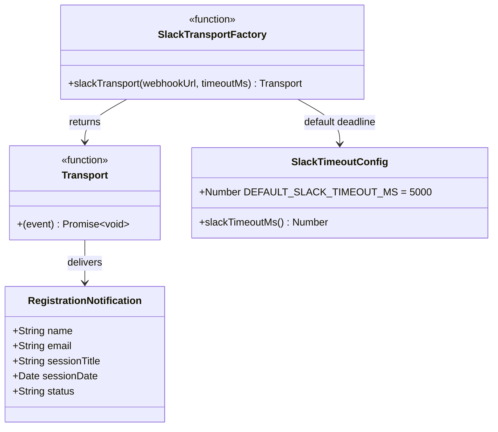

# Bound Slack Notification Delivery With a Deadline (LATC-114)

> Story card: **LATC-114** (team copy of **LATC-8**). Source analysis: `spdd/analysis/LATC-114-202611241000-[Analysis]-notify-on-registration-and-promotion.md`
> **Base:** `main`, which already implements LATC-8 (11/11 ACs). This canvas covers the **only** gap the analysis found, **N2**: a Slack webhook that never answers leaves a delivery pending forever. All other LATC-8 behaviour is unchanged.
> Defaults:
>
> - **T1 · Deadline:** 5 000 ms per Slack delivery, overridable with the env var `SLACK_TIMEOUT_MS` (a positive integer; anything else falls back to the default).
> - **T2 · Mechanism:** Node's built-in `AbortSignal.timeout(ms)` passed to `fetch`. No new dependency (Node 26).
> - **T3 · On timeout:** the transport throws `Slack webhook timed out after <ms>ms`. The existing `notify` catch logs `[notification] delivery failed: …` and swallows it, like any other failure.

## Requirements

Keep notification delivery from hanging: a slow or dead Slack webhook must end within a fixed time, be reported like any other delivery failure, and never affect registrations, promotions or test runs.

- Bound each Slack delivery by a deadline, so no delivery stays pending forever.
- Report a timeout through the existing "delivery failed" log, and keep fire-and-forget semantics.
- **Out of scope:** retries, queues or outboxes, changing the message format, console transport changes, banner/UI changes, and every other LATC-8 behaviour (already implemented).

## Entities

- **Unchanged:** `RegistrationNotification`, `Transport`, `consoleTransport`, `notify`, `formatMessage`, the test hooks.
- **Changed:** `slackTransport(webhookUrl, timeoutMs?)` gains an optional deadline argument. Existing one-argument calls keep working (backward compatible).
- **New:** `DEFAULT_SLACK_TIMEOUT_MS` and `slackTimeoutMs()`, which reads `SLACK_TIMEOUT_MS`.

## Approach

1. **Where the deadline lives:**
   - Inside the Slack transport, not in `notify`. The console transport can't hang, and a per-transport deadline keeps `notify` generic.
   - `defaultTransports()` passes `slackTimeoutMs()` when it builds the Slack transport.
2. **Technical implementation:**
   - `fetch(url, { …, signal: AbortSignal.timeout(timeoutMs) })`.
   - When the deadline fires, `fetch` rejects with a `DOMException` named `TimeoutError`. The transport turns that into `Error('Slack webhook timed out after <ms>ms')`, so the log line is readable. Any other error is rethrown unchanged.
   - No global error handler or HTTP change: notifications run after the response path, through `notify`.
3. **Business logic:**
   - A timeout is a delivery failure: logged once, swallowed, and other transports are unaffected (the existing `notify` behaviour).
   - `flushNotifications()` always resolves within roughly the deadline, even if Slack never answers.

## Structure

### Inheritance Relationships

1. `Transport` stays a function type `(event) => Promise<void>`. No classes, no custom exception types (a plain `Error`, as the existing non-2xx path does).

### Dependencies

1. `defaultTransports()` calls `slackTransport(webhook, slackTimeoutMs())`.
2. `slackTimeoutMs()` reads `process.env.SLACK_TIMEOUT_MS`.
3. `slackTransport` calls global `fetch` with `AbortSignal.timeout`.

### Layered Architecture

1. **Service layer:** `registrationService` is unchanged. It still calls `notify()` after commit.
2. **Notification module** (`api/src/notifications/index.ts`): the transports, the deadline and the config. This is the only production file touched.
3. **Tests:** `api/tests/unit/notifications.test.ts` only.

## Operations

Test-first. This is **one `/tdd` slice**: write the tests, confirm RED, implement, GREEN.

### 1. Unit Tests - `api/tests/unit/notifications.test.ts`

1. **Times out a silent webhook:**
   - Start a local `http` server that accepts the request and **never responds**.
   - Call `slackTransport(url, 100)(event)`.
   - Expect it to reject with a message containing `timed out after 100ms`, within roughly 1 s (Jest timeout 2 000 ms).
   - Close the server in `finally`. Call `server.closeAllConnections()` first so the hanging socket doesn't keep Jest open.
2. **Timeout is swallowed by notify:**
   - `setTransportsForTesting([slackTransport(url, 100)])` against the same silent server, with `console.error` spied.
   - Call `notify(event)`, then `await flushNotifications()`. It resolves (doesn't hang).
   - `console.error` was called with `'[notification] delivery failed: Slack webhook timed out after 100ms'`.
3. **Default and env override:**
   - `slackTimeoutMs()` returns `5000` when `SLACK_TIMEOUT_MS` is unset or invalid (`'abc'`, `'0'`, `'-5'`).
   - It returns `250` when `SLACK_TIMEOUT_MS='250'`.
   - Add `delete process.env.SLACK_TIMEOUT_MS` to the existing `afterEach`.
4. **Existing behaviour unchanged:** the current "posts a JSON text message…" and "uses Slack only when…" tests stay as they are and pass.

### 2. Notification Module - `api/src/notifications/index.ts`

1. `export const DEFAULT_SLACK_TIMEOUT_MS = 5000`.
2. `export function slackTimeoutMs(): number`:
   - Parse `process.env.SLACK_TIMEOUT_MS` with `Number(...)`.
   - Return it if it's an integer greater than 0, otherwise `DEFAULT_SLACK_TIMEOUT_MS`.
3. `export function slackTransport(webhookUrl: string, timeoutMs: number = DEFAULT_SLACK_TIMEOUT_MS): Transport`:
   - `try { res = await fetch(webhookUrl, { method, headers, body, signal: AbortSignal.timeout(timeoutMs) }) }`.
   - `catch (error: unknown)`:
     - If `error instanceof Error && error.name === 'TimeoutError'`, throw `new Error(\`Slack webhook timed out after ${timeoutMs}ms\`)`.
     - Otherwise rethrow `error`.
   - Keep the existing `if (!res.ok) throw new Error(\`Slack webhook responded ${res.status}\`)`.
4. `defaultTransports()`: `transports.push(slackTransport(webhook, slackTimeoutMs()))`.
5. Update the module's header comment: deliveries are bounded (the Slack deadline) as well as fire-and-forget.

### 3. Spec and Env Docs

1. `openspec/specs/notifications/spec.md`: under "Console and optional Slack delivery", add the requirement that a Slack delivery is abandoned after `SLACK_TIMEOUT_MS` (default 5000 ms) and logged as a failed delivery. Add a scenario "Slack does not respond".
2. `.env.example`: below the `SLACK_WEBHOOK_URL` line, add `# SLACK_TIMEOUT_MS=5000`.

### 4. Verify

1. `make test`, `make lint`, `make format-check` and `make reasons-lint` pass.
2. The new unit tests finish in under 2 s each, and Jest exits without an open-handle warning.

## Norms

1. **Typing:** no `any`. `catch (error: unknown)` with narrowing, as the module already does.
2. **Layering:** the deadline stays inside the notification module. Services and routes don't change.
3. **Error handling:** transports throw plain `Error`s with a readable message, and `notify` is the only place that logs and swallows. No new log formats.
4. **Configuration:** read env at transport construction time (`defaultTransports()` runs per `notify`), so tests can set or unset env per case.
5. **Testing:** real local HTTP servers for transport behaviour (existing pattern). Bind to `127.0.0.1`, and always close servers in `finally`.
6. **Style:** Prettier. Commits prefixed `[LATC-114]`. One short comment explaining why the deadline exists.

## Safeguards

1. **Functional constraints:**
   - A Slack delivery never takes longer than its deadline (+ ≤ 100 ms scheduling slack).
   - A timeout produces exactly one `delivery failed` log line.
   - Registration and promotion responses are unaffected.
2. **Performance constraints:** at most one timer per Slack delivery, released when `fetch` settles (`AbortSignal.timeout` does this). No polling.
3. **Security constraints:** the webhook URL is never logged (it contains a secret token), not in the timeout message either.
4. **Integration constraints:**
   - `slackTransport(url)` with one argument still works.
   - The console transport, `notify`, the test hooks and all existing LATC-8 tests (unit, integration, E2E) stay green unchanged.
5. **Business rule constraints:** notifications still fire only after commit, only for `confirmed` and `promoted`. Nothing about who is notified changes.
6. **Exception handling constraints:** no exception escapes `notify`. The timeout message is exactly `Slack webhook timed out after <ms>ms`, and non-timeout errors keep their original message.
7. **Technical constraints:** no new npm dependencies (built-in `fetch` and `AbortSignal.timeout`). No schema change.
8. **Data constraints:** `SLACK_TIMEOUT_MS` accepts positive integers only. Anything else uses 5000.
9. **API constraints:** no HTTP API change.
