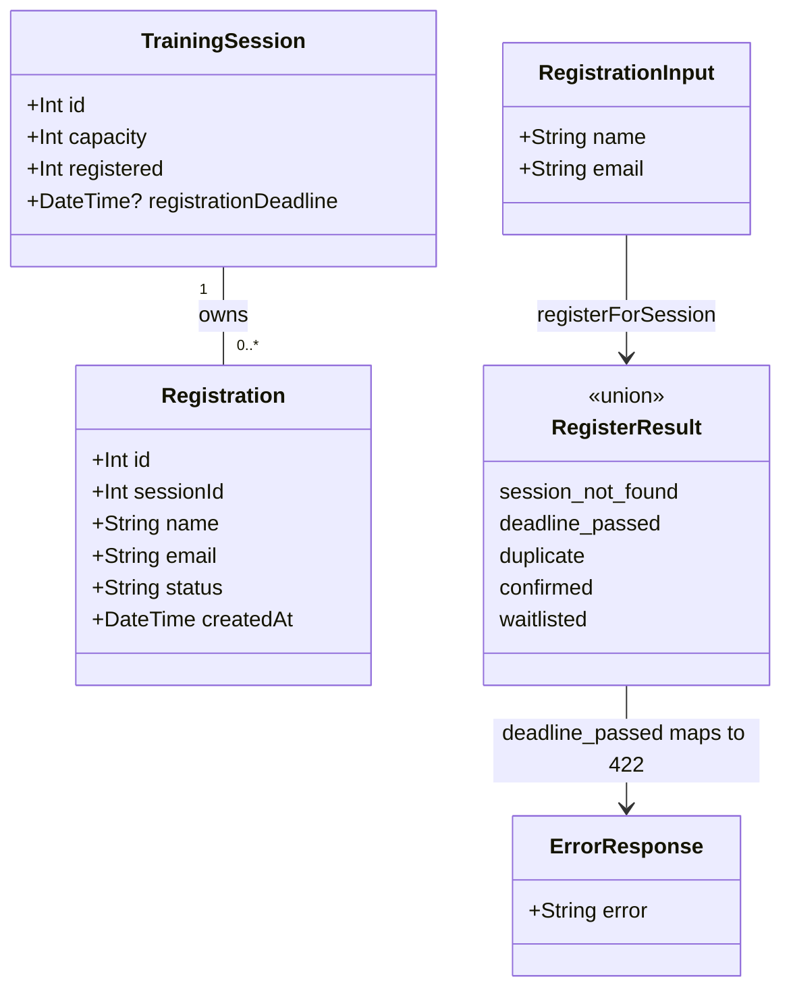

# Registration deadline prevents late registration (LATC-7, replica LATC-148)

> **Status:** already implemented on `main`. This canvas documents the existing implementation; `/spdd-generate` is a verification pass and changes code only if a gap is found.
>
> **Defaults applied (open questions resolved with the analysis recommendations):**
>
> 1. Boundary: registration at the exact deadline instant is allowed; strictly after (`now > registrationDeadline`) is rejected.
> 2. Waitlist: joining the waitlist after the deadline is also rejected with 422.
> 3. Cancellation and waitlist promotion after the deadline stay allowed (unchanged; flag to product if undesired).
> 4. Past-deadline UI hides the Register / Join waitlist button and shows "Registration closed".
> 5. The client maps any 422 from POST registrations to "Registration for this session has closed" (the deadline is the only 422 today); matching on the error body is not added.
> 6. Date label uses the existing `formatDateTime` helper (viewer locale); server cut-off is UTC.

## Requirements

Prevent employees from registering for a training session after its registration deadline, using the server clock as the authority, while showing the deadline (or that registration is closed) on the session card. Sessions with no deadline stay open at any time. Rejected registrations have no side effects. Out of scope: an organiser UI to set deadlines, automatic status change at the deadline, timezones beyond UTC.

## Entities

No new entities or fields. `registrationDeadline` already exists as a nullable UTC `DateTime` in the Prisma schema and as `registrationDeadline: string | null` in `app/src/types/index.ts`.

## Approach

1. Enforcement in the service layer:
   - `registrationService.registerForSession(sessionId, input, now = new Date())` checks the deadline inside the register transaction, after loading the session and before the duplicate check and seat claim.
   - Returns the `{ kind: 'deadline_passed' }` result; no exceptions for business outcomes.
   - Injected `now` keeps boundary tests deterministic without mocking the clock.
2. HTTP mapping in the route:
   - `routes/registrations.ts` validates input first (400), then calls the service and maps `deadline_passed` to `422 { error: "Registration deadline has passed" }`.
3. Frontend display (display only, not enforcement):
   - `RegistrationPanel` computes `isClosed` from `registrationDeadline` and the client clock; shows "Registration closes: <formatDateTime>" when open, "Registration closed" in place of the button when closed, nothing when null.
   - `RegistrationForm` shows the inline error "Registration for this session has closed" on a 422.
4. Rejections have no side effects: no Registration row, `registered` unchanged, no AuditLog row, no notification.

## Structure

### Inheritance Relationships

1. `RegisterResult` is a discriminated union of outcome kinds; `deadline_passed` is one member.

### Dependencies

1. `routes/registrations.ts` calls `validateRegistrationInput` and `registerForSession` in `services/registrationService.ts`.
2. `registrationService` uses the shared client from `lib/prisma.ts` inside `prisma.$transaction`.
3. `RegistrationPanel` renders `RegistrationForm`; `RegistrationForm` calls `app/src/api.ts`.

### Layered Architecture

1. Route layer: parse/validate body, map result kinds to HTTP status and body.
2. Service layer: deadline rule, duplicate check, seat claim / waitlist, audit, all inside one transaction.
3. Data layer: Prisma `TrainingSession`, `Registration`, `AuditLog`.
4. UI layer: display deadline state and surface the server 422.

## Operations

### 1. Verify schema - TrainingSession.registrationDeadline

1. Confirm `registrationDeadline DateTime?` exists in `api/prisma/schema.prisma` and is returned in session payloads (list and detail).
2. Confirm seed creates one session with a future deadline (+14 days) and one with a past deadline (-1 day).
3. No schema change; do not run `prisma db push` for this story.

### 2. Verify service - registerForSession deadline check

1. In `api/src/services/registrationService.ts`, inside the transaction, after `session_not_found`:
   - `if (session.registrationDeadline && now > session.registrationDeadline) return { kind: 'deadline_passed' }`.
2. The check runs before the capacity check, so a full session past its deadline returns `deadline_passed`, not `waitlisted`.
3. No writes happen on this path (no Registration, no counter change, no AuditLog), and no notification is scheduled.

### 3. Verify route - POST /api/training-sessions/:id/registrations

1. Invalid body still returns 400 before the service is called.
2. `case 'deadline_passed'`: `res.status(422).json({ error: 'Registration deadline has passed' })`.

### 4. Verify UI - RegistrationPanel and RegistrationForm

1. `RegistrationPanel`: `deadline && !isClosed` shows "Registration closes: {formatDateTime(...)}"; `isClosed` replaces the Register / Join waitlist button with "Registration closed"; null deadline shows no label.
2. An existing active registration for the user is still shown (and cancellable) after the deadline.
3. `RegistrationForm`: on `result.status === 422` show inline "Registration for this session has closed".

### 5. Verify tests cover each AC

1. `api/tests/integration/deadline.test.ts`: 422 with exact body after the deadline; allowed at the exact instant; rejected at +1ms; allowed with null deadline; full session past deadline returns 422; no Registration/AuditLog written and `registered` unchanged; field exposed in session payloads.
2. `e2e/tests/latc-7-deadline.spec.ts`: label for a future deadline, "Registration closed" for a past deadline, inline error when submitting across the cut-off.
3. Add a missing test only if one of the above is not covered; do not change production code unless a test proves a gap.

## Norms

1. No `any`; use the typed `RegisterResult` union and `RegistrationInput`.
2. No Prisma in routes; all data access in `registrationService` via `lib/prisma.ts`.
3. Business outcomes are returned as result kinds, mapped to HTTP in the route; unexpected errors propagate to the Express error handler.
4. Error bodies are `{ error: string }` with the exact story wording.
5. Tests: integration tests create their own sessions with `createTestSession()` and clean up; pass `now` explicitly for boundary cases.
6. Comments reference the story key (LATC-7) where the rule is enforced.

## Safeguards

1. Functional: `now > registrationDeadline` rejects with 422; equality is allowed; null deadline never rejects.
2. Business rule: the deadline blocks both confirmed and waitlisted registrations; it does not block cancellation or waitlist promotion.
3. Atomicity: the deadline read happens in the same transaction as the seat claim; a rejected request writes nothing (no Registration, no `registered` change, no AuditLog, no notification).
4. Security: the server clock is authoritative; client time is display only and never sent or trusted.
5. API contract: status 422 and body exactly `{ "error": "Registration deadline has passed" }`; validation errors keep returning 400 first; 404 for unknown session unchanged.
6. UI contract: exact texts "Registration closes: <date>", "Registration closed", "Registration for this session has closed".
7. Data: no schema change; deadlines stored and compared as UTC instants.
8. Scope: no organiser UI, no scheduled status change, no timezone handling beyond UTC.
9. Test integrity: do not weaken or delete existing deadline, atomicity, or e2e tests.
