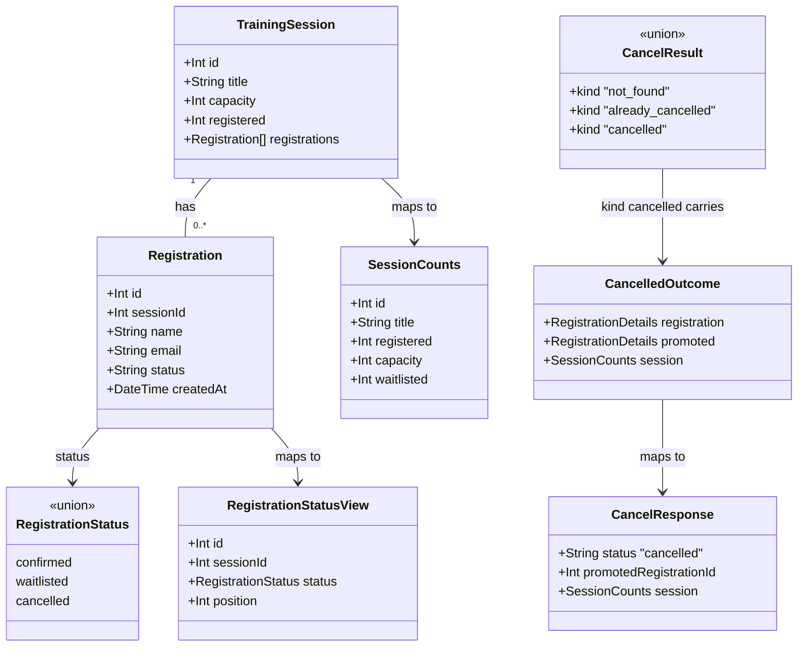

# Cancel a Registration and Promote the First Waitlisted Employee (LATC-71)

> Story card: **LATC-71** (team copy of **LATC-5**). Source analysis: `spdd/analysis/LATC-71-202611231712-[Analysis]-promote-waitlisted-after-cancellation.md`
>
> **Prerequisite gate**: LATC-2 (`spdd/prompt/LATC-2-202611231415-[Feat]-api-register-for-training-session.md`) and LATC-3 (`spdd/prompt/LATC-3-202611231422-[Feat]-api-waitlist-when-session-full.md`) must be generated on `latc-71-waitlist-promotion` **first**, in that order, with `make test` green after each. This canvas is a **delta** on that code. It relies on `Registration`, `REGISTRATION_STATUS`, `RegistrationStatus`, `Tx`, `details()`, `sessionCounts()`, `waitlistPosition()`, `routes/registrations.ts` (`mergeParams`, `parseId`), `app/src/api.ts` (`ApiResult`) and the LATC-3 `TrainingSessionCard`.
>
> Open questions from the analysis, resolved as defaults (change before generating if you disagree):
>
> - **P1 · Scope**: LATC-4 cancellation is built **in this story**, together with promotion (one transaction). LATC-4's ACs are included.
> - **P2 · "Confirmed after refresh"**: the browser remembers `{ registrationId }` per session in `localStorage`. A new `GET /api/training-sessions/:id/registrations/:registrationId` returns that one registration's current status and position. There is no public list of registrations.
> - **P3 · Notification (WH-8)**: not sent. The service returns the promoted registration, and a comment marks the LATC-8 hook point.
> - **P4 · Cancelling a waitlisted registration**: allowed. It leaves the queue with no promotion and no counter change, and the response has `promotedRegistrationId: null`.
> - **P5 · Order**: the waitlist head is the lowest `id` among `waitlisted` rows. This is the same order as LATC-3's `position`, and equivalent to "by `createdAt`".
> - **P6 · Session/registration mismatch**: 404 "Registration not found".
> - **P7 · Over-capacity** (an admin lowered capacity): promote only if, after the cancel, confirmed seats < capacity. Otherwise only decrement.

## Requirements

Free a confirmed seat when an employee cancels, and give it straight to the first person waiting, so seats never sit empty while there is demand and the waitlist stays first-come-first-served.

- Implement cancellation of a registration by its id, scoped to its session (LATC-4).
- Promote the head of the waitlist to `confirmed` inside the same transaction whenever a **confirmed** seat is freed (LATC-5).
- Keep seat accounting exact: `registered` = confirmed seats ≤ capacity. Promotion is net zero, and cancelling without promotion is −1.
- Let the canceller see only a standard cancellation message, and let the promoted employee see "Confirmed" after a refresh.
- **Out of scope**: sending notifications (LATC-8), organiser-initiated cancellation or promotion, authentication, duplicate-registration checks, a maximum waitlist size.

## Entities

- **No schema change.** `status` (with `cancelled` reserved by LATC-3) and the `[sessionId, status]` index already cover cancel, promote and lookup.
- **New**: `CancelResult` (service outcome union), `CancelResponse` (HTTP body), `RegistrationStatusView` (the one-registration read for P2). `promoted` is `RegistrationDetails | null`.
- **Unchanged**: `RegistrationInput`, `RegisterResult`, `RegistrationResponse`, `SessionCounts` (reused as is), and the POST contract.

## Approach

1. **API design**:
   - `DELETE /api/training-sessions/:id/registrations/:registrationId` returns `200 { status: 'cancelled', promotedRegistrationId: number | null, session: SessionCounts }`, `400` for invalid ids, `404` for an unknown registration or a session mismatch, and `409` when it is already cancelled. The extra `session` field is additive: it lets the UI refresh counts without a second call, and it keeps LATC-4's `{ status: 'cancelled' }` contract.
   - `GET /api/training-sessions/:id/registrations/:registrationId` returns `200 { id, sessionId, status, position | null }` (P2) or `400`/`404`. It deliberately omits name and email, because the id is the only "identity".
   - Both are added to the existing `routes/registrations.ts` router, which is already mounted under `/api/training-sessions/:id/registrations`.

2. **Technical implementation**:
   - One interactive `prisma.$transaction` per cancellation, with LATC-2's `{ maxWait: 5000, timeout: 10000 }`.
   - **Conditional state transitions** (D5). Cancel is `updateMany({ where: { id, sessionId, status: <loaded status> }, data: { status: 'cancelled' } })`. Promotion is `updateMany({ where: { id: headId, status: 'waitlisted' }, data: { status: 'confirmed' } })`. A count of 0 means a concurrent writer won: re-read and retry the head selection once inside the transaction. This keeps the logic correct beyond SQLite's write lock.
   - **Seat accounting without a −1/+1 dance** (D3): on promotion `registered` isn't written at all. Without promotion it's `updateMany({ where: { id: sessionId, registered: { gt: 0 } }, data: { registered: { decrement: 1 } } })`.
   - Error handling follows LATC-2 and LATC-3: the service returns a result union, the route uses an exhaustive `switch`, route `try/catch` with `console.error` and a generic 500. The `app.ts` global handler isn't used.

3. **Business logic**:
   - Only a `confirmed → cancelled` transition frees a seat. `waitlisted → cancelled` (P4) just leaves the queue. `cancelled` is terminal (409).
   - The waitlist head is the lowest-`id` `waitlisted` row of **the same session** (P5). There's at most one promotion per cancellation.
   - Promote only if `confirmedAfterCancel < capacity` (P7). In the normal case this is always true.
   - The promoted registration is returned from the service as the hook point for LATC-8 (P3). Nothing is sent.

4. **Frontend**:
   - `api.ts` gains `cancelRegistration` and `getRegistration`.
   - Card: after a successful register (201 or 202), store `{ registrationId }` under `workshophub.registration.<sessionId>` in `localStorage`, wrapped in try/catch. On mount, if an id is stored, `getRegistration` restores `myStatus` and `myPosition`, so a promoted employee sees "Confirmed" after a refresh. A 404 clears the key.
   - "Cancel Registration" is shown when `myStatus` is `confirmed` or `waitlisted`. It uses `window.confirm("Are you sure you want to cancel your registration for <title>?")`. On 200 it shows "Your registration has been cancelled", sets counts from `data.session`, sets `myStatus = 'cancelled'` and shows a disabled "Cancelled" label. `promotedRegistrationId` is **not** shown (AC1).

5. **Risks**:
   - The prerequisites aren't built yet, so stop at the gate if LATC-2 or LATC-3 tests aren't green.
   - SQLite lock contention in the concurrent-cancel test: keep it small (capacity 2, 2 confirmed, 2 waitlisted, 2 parallel cancels).
   - Counter drift: every scenario test also asserts `registered === count(confirmed)`.

## Structure

### Inheritance Relationships

1. `CancelResult` is a discriminated union on `kind`: `not_found`, `already_cancelled`, and `cancelled` (which carries `registration`, `promoted` and `session`).
2. `RegistrationLookupResult` is `{ kind: 'not_found' } | { kind: 'found'; view: RegistrationStatusView }`.
3. Status values come from LATC-3's `REGISTRATION_STATUS` (`as const`) and `RegistrationStatus`. No classes and no custom exceptions, as in LATC-2 and LATC-3.

### Dependencies

1. `routes/registrations.ts`: `DELETE /:registrationId` calls `cancelRegistration`, and `GET /:registrationId` calls `getRegistrationStatus` (both in `services/registrationService.ts`).
2. `registrationService.cancelRegistration` calls `lib/prisma.$transaction`, the internal `promoteNext(tx, sessionId)`, LATC-3's `sessionCounts(tx, sessionId)` and `details(row)`.
3. `registrationService.getRegistrationStatus` calls `lib/prisma.registration.findFirst` and LATC-3's `waitlistPosition(prisma, …)`. The helper's parameter type widens from `Tx` to `Tx | typeof prisma`.
4. `TrainingSessionCard.tsx` calls `api.registerForSession`, `api.cancelRegistration`, `api.getRegistration` and `localStorage`.

### Layered Architecture

1. **Route layer**: parse and validate both ids (`parseId`), call the service, map `kind` to 200/404/409, shape the JSON. No Prisma import.
2. **Service layer**: the cancel-and-promote transaction, the seat-accounting rules, head selection, conditional transitions, the status lookup and position derivation.
3. **Data layer**: the existing `Registration.status` and `[sessionId, status]` index. No schema changes.
4. **Client layer**: `api.ts` typed wrappers that return `ApiResult<T>`.
5. **UI layer**: the card keeps `myRegistrationId`, `myStatus` and `myPosition`, persisted in `localStorage`, and has the cancel flow with confirmation.
6. **Error handling**: per-route `try/catch`, generic 500 bodies, as in LATC-2 and LATC-3.

## Operations

Test-first: write each test, watch it fail, then implement. **Step 0 is a gate. Don't start step 1 until it passes.**

### 0. Gate - prerequisites

1. `/spdd-generate` the LATC-2 canvas, then the LATC-3 canvas, on this branch. Commit each one separately (`[LATC-71] Build LATC-2 registration prerequisite`, `[LATC-71] Build LATC-3 waitlist prerequisite`).
2. Done when `make test` is green and `registrationService.ts` exports `REGISTRATION_STATUS`, `RegistrationStatus`, `SessionCounts` (with `waitlisted`), and has the `sessionCounts`, `waitlistPosition` and `details` helpers.

### 1. Write Integration Tests - `api/tests/integration/registrations.test.ts` (new `describe('cancel and promote')`)

1. Helpers in the file:
   - `seed(capacity, confirmed, waitlisted)` creates a session with the existing `createSession(capacity, confirmed)`, then inserts `confirmed` rows and `waitlisted` rows (sequential `create`s so ids ascend). It returns `{ sessionId, confirmedIds, waitlistedIds }`.
   - `assertCounterConsistent(sessionId)` checks that the session's `registered` equals `count({ sessionId, status: 'confirmed' })`.
   - Clean up in the existing `afterAll`.
2. DELETE cases:
   - Cancel confirmed, waitlist empty (`seed(2,2,0)`) → 200 `{ status: 'cancelled', promotedRegistrationId: null }`, `session.registered === 1`. Row status `cancelled`. Counter consistent.
   - Cancel confirmed with a waitlist (`seed(1,1,2)`) → 200 with `promotedRegistrationId === waitlistedIds[0]`. `session.registered === 1` (unchanged), `session.waitlisted === 1`. The DB has the first waitlisted row `confirmed` and the second still `waitlisted`. Counter consistent.
   - A second cancel of the new confirmed seat → promotes `waitlistedIds[1]`.
   - Cancel a waitlisted registration (`seed(1,1,2)`, cancel `waitlistedIds[0]`) → 200 with `promotedRegistrationId: null`. `registered` stays 1. A GET of `waitlistedIds[1]` shows `position === 1`.
   - Already cancelled → 409 `{ error: 'Registration is already cancelled' }`, and no row or counter changes.
   - Unknown registration `999999` → 404. A registration from another session → 404 (P6), and its row is untouched.
   - `/abc/registrations/1` and `/1/registrations/abc` → 400.
   - Over capacity (P7): `seed(2,2,1)`, then set `capacity = 1` directly, cancel one confirmed → `promotedRegistrationId: null`, `registered === 1`.
   - Concurrency: `seed(2,2,2)`, then cancel both confirmed in parallel → both 200. The two `promotedRegistrationId` values are distinct and equal the set of `waitlistedIds`. `registered === 2`, 0 waitlisted. Counter consistent.
3. GET cases:
   - Waitlisted → `{ id, sessionId, status: 'waitlisted', position: 1 }`.
   - After the promotion that cancels it → `status: 'confirmed'`, `position: null` (AC2 at the API level).
   - Cancelled → `status: 'cancelled'`, `position: null`.
   - Unknown or mismatched → 404. Invalid ids → 400.
   - The body has no `name` or `email` keys.

### 2. Write Unit Tests - `api/tests/unit/registrationService.test.ts`

1. Mock `lib/prisma` as `trainingSessionService.test.ts` does, with `$transaction` invoking the callback on a mock `tx`.
2. `cancelRegistration`:
   - With `findFirst` → null, returns `{ kind: 'not_found' }` and makes no `updateMany` calls.
   - With a `cancelled` row, returns `{ kind: 'already_cancelled' }` and makes no writes.
   - Waitlisted row → one `updateMany` (cancel), and no `trainingSession` writes.
   - Confirmed row with a waitlist head → cancel `updateMany` plus promote `updateMany`, and `trainingSession.updateMany` is **not** called.
   - Confirmed row with no head → the decrement `updateMany` is called with `registered: { gt: 0 }`.

### 3. Implement Service - `api/src/services/registrationService.ts`

1. Types:
   - `export type CancelResult = { kind: 'not_found' } | { kind: 'already_cancelled' } | { kind: 'cancelled'; registration: RegistrationDetails; promoted: RegistrationDetails | null; session: SessionCounts }`
   - `export interface RegistrationStatusView { id: number; sessionId: number; status: RegistrationStatus; position: number | null }`
   - `export type RegistrationLookupResult = { kind: 'not_found' } | { kind: 'found'; view: RegistrationStatusView }`
2. Widen LATC-3's `waitlistPosition` first parameter to `Tx | typeof prisma`. Its behaviour is unchanged.
3. Internal `promoteNext(tx: Tx, sessionId: number): Promise<RegistrationDetails | null>`
   - Loop at most 2 attempts:
     - `head = tx.registration.findFirst({ where: { sessionId, status: REGISTRATION_STATUS.waitlisted }, orderBy: { id: 'asc' } })`. If null, return `null`.
     - `won = tx.registration.updateMany({ where: { id: head.id, status: REGISTRATION_STATUS.waitlisted }, data: { status: REGISTRATION_STATUS.confirmed } })`.
     - If `won.count === 1`, return `details({ ...head, status: REGISTRATION_STATUS.confirmed })`.
   - After 2 lost races, return `null`. The caller then decrements, so the seat is never lost.
   - Comment: the order is by `id` to match LATC-3's `position` (P5).
4. `export async function cancelRegistration(sessionId: number, registrationId: number): Promise<CancelResult>`
   - `prisma.$transaction(async (tx) => { … }, { maxWait: 5000, timeout: 10000 })`:
     - `reg = tx.registration.findFirst({ where: { id: registrationId, sessionId } })`. If null, return `{ kind: 'not_found' }` (this covers P6).
     - If `reg.status === cancelled`, return `{ kind: 'already_cancelled' }`.
     - `done = tx.registration.updateMany({ where: { id: reg.id, status: reg.status }, data: { status: cancelled } })`. If `done.count === 0`, return `{ kind: 'already_cancelled' }` (a concurrent cancel won).
     - `promoted = null`.
     - If `reg.status === confirmed`:
       - `session = tx.trainingSession.findUniqueOrThrow({ where: { id: sessionId } })`.
       - If `session.registered - 1 < session.capacity` (P7), set `promoted = await promoteNext(tx, sessionId)`.
       - If `promoted === null`, run `tx.trainingSession.updateMany({ where: { id: sessionId, registered: { gt: 0 } }, data: { registered: { decrement: 1 } } })`.
       - Comment: on promotion the counter is untouched, which is net zero (D3).
     - `// LATC-8: notify promoted employee here (out of scope for LATC-71)`
     - Return `{ kind: 'cancelled', registration: details({ ...reg, status: cancelled }), promoted, session: await sessionCounts(tx, sessionId) }`.
   - Don't catch errors in the service.
5. `export async function getRegistrationStatus(sessionId: number, registrationId: number): Promise<RegistrationLookupResult>`
   - `reg = prisma.registration.findFirst({ where: { id: registrationId, sessionId }, select: { id: true, sessionId: true, status: true } })`. If null, return `{ kind: 'not_found' }`.
   - `status = reg.status as RegistrationStatus`.
   - `position = status === waitlisted ? await waitlistPosition(prisma, sessionId, reg.id) : null`.
   - Return `{ kind: 'found', view: { id, sessionId, status, position } }`.

### 4. Implement Routes - `api/src/routes/registrations.ts`

1. Reuse `parseId`. Add a local `parseIds(req)` returning `{ sessionId, registrationId } | null`. Either id invalid → 400 `{ error: 'Invalid session ID' }` or `{ error: 'Invalid registration ID' }` (session id checked first).
2. `router.delete('/:registrationId', async (req: Request<{ id: string; registrationId: string }>, res) => { try { … } catch { … } })`:
   - `result = await cancelRegistration(sessionId, registrationId)`.
   - `switch (result.kind)`:
     - `not_found` → 404 `{ error: 'Registration not found' }`
     - `already_cancelled` → 409 `{ error: 'Registration is already cancelled' }`
     - `cancelled` → 200 `{ status: 'cancelled', promotedRegistrationId: result.promoted?.id ?? null, session: result.session }`
   - `catch`: `console.error('Error cancelling registration:', error)`, then 500 `{ error: 'Failed to cancel registration' }`.
3. `router.get('/:registrationId', …)`: `not_found` → 404 `{ error: 'Registration not found' }`, `found` → 200 `result.view`. In the catch, `console.error('Error fetching registration:', error)`, then 500 `{ error: 'Failed to fetch registration' }`.
4. Both switches are exhaustive with no `default`. No Prisma import. `app.ts` is unchanged (the router is already mounted with `mergeParams`).

### 5. Update Frontend Types - `app/src/types/index.ts`

1. `export interface CancelResponse { status: 'cancelled'; promotedRegistrationId: number | null; session: RegistrationResponse['session'] }`
2. `export interface RegistrationStatusView { id: number; sessionId: number; status: RegistrationStatus; position: number | null }`

### 6. Update HTTP Client - `app/src/api.ts`

1. Extract LATC-2's response and error handling into a private `async function request<T>(url: string, init: RequestInit, fallback: string): Promise<ApiResult<T>>`. Re-point `registerForSession` to it, with no behaviour change.
2. `cancelRegistration(sessionId: number, registrationId: number): Promise<ApiResult<CancelResponse>>` sends `DELETE …/registrations/${registrationId}`, with the fallback 'Cancellation failed'.
3. `getRegistration(sessionId: number, registrationId: number): Promise<ApiResult<RegistrationStatusView>>` sends `GET …/registrations/${registrationId}`, with the fallback 'Could not load registration'.

### 7. Update Component - `app/src/components/TrainingSessionCard.tsx`

1. Storage helpers (module scope): `storageKey = (id: number) => 'workshophub.registration.' + id`, `loadMyRegistrationId(sessionId): number | null`, `saveMyRegistrationId(sessionId, regId)` and `clearMyRegistrationId(sessionId)`. Wrap each in `try/catch`. Ignore storage failures.
2. New state: `myRegistrationId: number | null`, `myStatus: RegistrationStatus | null`, and LATC-3's `myPosition`. Plus `cancelling: boolean`.
3. `useEffect` on mount: `id = loadMyRegistrationId(session.id)`. If set, call `getRegistration`:
   - `ok` → set `myRegistrationId`, `myStatus = data.status`, `myPosition = data.position`.
   - `status === 404` → clear the key.
   - Other errors → ignore silently.
4. Register success (both 201 and 202): `saveMyRegistrationId(session.id, data.id)`, set `myRegistrationId` and `myStatus = data.status`. Keep LATC-3's existing handling.
5. `handleCancel`:
   - `window.confirm(\`Are you sure you want to cancel your registration for ${session.title}?\`)`. If declined, return.
   - Call `cancelRegistration`. On `ok`: set `registered = data.session.registered`, `waitlisted = data.session.waitlisted`, `myStatus = 'cancelled'`, `myPosition = null`, confirmation 'Your registration has been cancelled'.
   - On a 409: `myStatus = 'cancelled'`. Other failures set `error`.
   - Never show `promotedRegistrationId` (AC1).
6. Render:
   - `myStatus === 'confirmed'` → "Your status: Confirmed".
   - `myStatus === 'waitlisted'` → LATC-3's "Waitlisted (position N)" line.
   - `confirmed`/`waitlisted` → a "Cancel Registration" button (`disabled={cancelling}`).
   - `cancelled` → a disabled "Cancelled" label, and the Register/Join button is shown again.
7. CSS: `session-card__cancel` and `session-card__status--confirmed` in `TrainingSessionCard.css`.

### 8. Verify

1. `make test`, `make lint`, `make format-check` and `make reasons-lint` are clean.
2. Manual (`make dev`), using two browser profiles A and B on a capacity-1 session:
   - A registers (Confirmed).
   - B joins the waitlist (position 1).
   - A cancels and confirms the prompt, sees only "Your registration has been cancelled", and the count is unchanged.
   - B refreshes and sees "Your status: Confirmed".
3. `make reset-db` afterwards.

## Norms

1. **Typing**: no `any`. Statuses come only from `REGISTRATION_STATUS` and `RegistrationStatus`. Casts are allowed only when mapping Prisma rows and parsing JSON at the client boundary. Result unions are discriminated on `kind`, and route switches are exhaustive without `default`.
2. **Layering**: route → service → `lib/prisma`. Routes never import Prisma. Seat accounting, head selection and position live only in the service. The UI never computes counts and always takes them from the response.
3. **Error handling**:
   - Expected outcomes (not found, already cancelled) are union variants mapped in the route.
   - Unexpected errors: route `try/catch`, `console.error('<context>:', error)`, a generic `{ error }` 500.
   - Error body `{ error: string, details?: string[] }`. Never stack traces or Prisma messages.
4. **Data integrity**:
   - Every write for one cancellation is in one `$transaction`.
   - Every status change is conditional on the expected current status, and the affected count is checked.
   - Promotion never writes `registered`.
5. **Validation**: ids parse as positive integers with the shared `parseId`. Request bodies on DELETE and GET are ignored.
6. **Logging**: errors only, with a context prefix. Don't log names, emails or registration ids on success paths.
7. **Testing**: TDD. Integration tests seed their own sessions and registrations, assert `registered === count(confirmed)` after each mutation, and clean up in `afterAll`. Unit tests mock `lib/prisma`. Integration tests start the app once per file with `app.listen(0, '127.0.0.1')` and send requests to that server, not `request(app)`: supertest's default listens on `::` but sends to `127.0.0.1`, so on a machine with other local servers a request can hit a foreign process (observed: 1 in 1,000 requests got another app's 401).
8. **Style and docs**: Prettier (no semicolons, single quotes). Commits prefixed `[LATC-71]`. Short comments only for non-obvious choices (net-zero promotion, id ordering, the retry on a lost race, the LATC-8 hook).

## Safeguards

1. **Functional constraints**:
   - Cancelling a confirmed registration with ≥1 waitlisted promotes exactly one registration (the lowest-id waitlisted in that session) and leaves `registered` unchanged.
   - With an empty waitlist it decrements `registered` by exactly 1.
   - Cancelling a waitlisted registration changes nothing but its own status.
   - 400, 404 and 409 paths write nothing.
2. **Performance constraints**: at most 8 queries per cancel transaction (find, cancel, session, head, promote, decrement or no-op, counts ×2). The status lookup is ≤2 queries. All waitlist queries use the `[sessionId, status]` index.
3. **Security constraints**:
   - No raw SQL.
   - No name or email in the GET response.
   - Registration ids are always scoped by `sessionId`, so one session's URL can't cancel or read another session's registration.
   - No stack traces in responses. `localStorage` holds only numeric ids.
4. **Integration constraints**:
   - LATC-1, LATC-2 and LATC-3 tests stay green, and the POST contract is unchanged.
   - The `app.ts` mounting is unchanged.
   - `admin.ts` and `/search` are untouched.
   - The DELETE response is a superset of LATC-4's `{ status: 'cancelled' }`.
5. **Business rule constraints**:
   - `registered` equals `count(confirmed)` and is ≤ capacity after every operation (P7 respected).
   - At most one promotion per cancellation.
   - Two concurrent cancellations promote two distinct registrations (concurrency test).
   - `cancelled` is terminal.
6. **Exception handling constraints**:
   - Every non-2xx response has a clear `error` message: 'Invalid session ID', 'Invalid registration ID', 'Registration not found', 'Registration is already cancelled', 'Failed to cancel registration', 'Failed to fetch registration'.
   - Outcomes are classified by `kind`.
   - Nothing internal is exposed. Every unexpected error is caught in the route.
7. **Technical constraints**: Prisma + SQLite with `prisma db push`, and **no schema change** in this story. No new dependencies. TypeScript strict and ESLint clean. Transaction timeouts as in LATC-2.
8. **Data constraints**:
   - Status transitions allowed: `confirmed → cancelled`, `waitlisted → cancelled`, `waitlisted → confirmed` (promotion only).
   - Never `cancelled → *` and never `confirmed → waitlisted`.
   - `registered` never goes below 0.
9. **API constraints**:
   - `DELETE /api/training-sessions/:id/registrations/:registrationId` returns:
     - `200` with `{ status: 'cancelled', promotedRegistrationId: number | null, session: { id, title, registered, capacity, waitlisted } }`
     - `400` with `{ error }`, `404` with `{ error: 'Registration not found' }`, `409` with `{ error: 'Registration is already cancelled' }`, `500` with `{ error: 'Failed to cancel registration' }`
   - `GET /api/training-sessions/:id/registrations/:registrationId` returns:
     - `200` with `{ id, sessionId, status, position: number | null }`
     - `400`, `404` or `500` with `{ error }`
