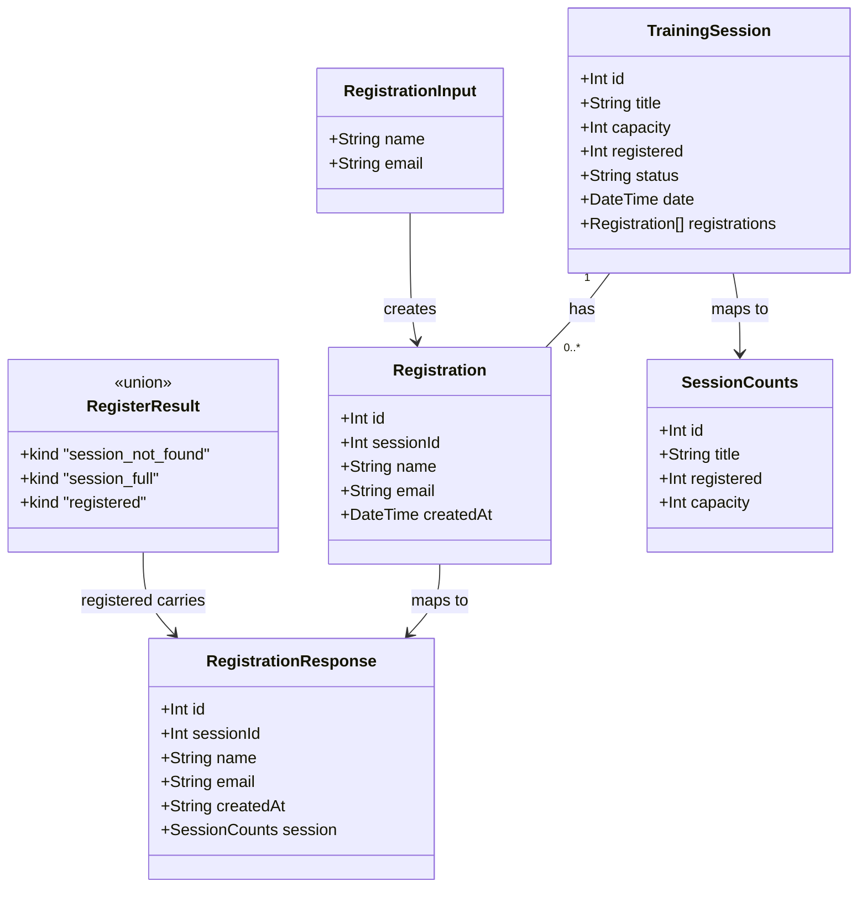

# Employee Registers for an Available Training Session (LATC-86)

> Team copy of LATC-2 (identical requirement, same baseline). Analysis: `spdd/analysis/LATC-86-202611231811-[Analysis]-register-for-training-session.md`. Commit prefix `[LATC-86]`.

> Source analysis: `spdd/analysis/LATC-2-202611231414-[Analysis]-register-for-training-session.md`
> Open questions from the analysis, resolved here as defaults (change before generating if you disagree):
>
> - **D1 · 201 body**: the registration (`id, sessionId, name, email, createdAt`) plus `session: { id, title, registered, capacity }`.
> - **D2 · Email format**: a malformed email returns 400. This is stricter than the AC requires, but cheap, and later stories depend on clean emails.
> - **D3 · Inactive sessions**: no `status` check. It is out of scope for LATC-2, and adding it would invent a rule.
> - **D4 · Non-numeric / non-positive id**: 400 "Invalid session ID", matching the existing `GET /:id`.
> - **D5 · Test data**: integration tests create their own sessions and delete them afterwards. They never change seed rows.
> - **D6 · Full-session UI**: the register button is **disabled**, and the existing "Full" badge stays.

## Requirements

Let an employee claim a seat on a training session with only their name and email, so they secure their place before it fills up. The system must never over-book a session, even when requests arrive at the same time.

- Implement `POST /api/training-sessions/:id/registrations` that records a registration and takes one seat in a single atomic step.
- Reject invalid input (400), unknown sessions (404) and full sessions (409), changing nothing in each case.
- Let the employee register from the session card, see a confirmation, and see the updated count without reloading the page.
- **Out of scope**: duplicate prevention, waitlist (LATC-3), cancellation (LATC-4), notifications (LATC-8), deadlines (LATC-7), authentication.

## Entities

- `TrainingSession` is **unchanged** apart from the new back-relation. `registered` stays a stored counter.
- `Registration` is new and has no `status` field. LATC-3 adds the status lifecycle. Don't add it early.
- `RegisterResult` is a TypeScript discriminated union. The service returns outcomes instead of throwing for expected business cases. An invalid session id never reaches the service: the route rejects it (Operations 5.3).

## Approach

1. **API design**:
   - Add a nested router mounted at `/api/training-sessions/:id/registrations` (`mergeParams: true`), separate from `training-sessions.ts`, so the planted `/search` issue stays isolated.
   - Status mapping: 201 registered · 400 invalid id or body · 404 unknown session · 409 full · 500 unexpected.
   - The response carries the updated session counts (D1), so the UI updates without fetching again.

2. **Technical implementation**:
   - Express + Prisma (SQLite), following the reference layering `routes → services → lib/prisma`. The route never imports Prisma.
   - **Race-safe seat claim**: inside `prisma.$transaction`, run one conditional `updateMany` on `TrainingSession` where `id = sessionId AND registered < capacity`, and increment `registered` by 1. `count === 0` means full. When it succeeds, create the `Registration` in the same transaction. Both commit or neither does.
   - Stored counter vs computed: **keep the stored counter**. It is already read by the list UI and seed data.
   - **Error handling**: expected outcomes go through the result union and the route's `switch`. Unexpected errors are caught in the route and logged with `console.error`, and the client gets a generic 500 `{ error }`. Do **not** rely on the global handler in `app.ts`, which leaks `err.stack`. Express has no `@ControllerAdvice` equivalent here, and adding a global handler is out of scope.

3. **Business logic**:
   - Validation is a pure function: `name` and `email` must be non-empty strings after trimming, and `email` must match a simple `local@domain.tld` pattern (D2). It returns a list of messages.
   - Normalise on write: trim `name`, trim and lower-case `email`.
   - Order of checks: id → body → session exists → seat claim. A missing session is detected before the claim, so a 404 changes nothing.

4. **Frontend**:
   - Add `app/src/api.ts` with a typed `registerForSession` that returns `{ ok: true, data } | { ok: false, status, error }`. The list page's inline fetch is not refactored.
   - `TrainingSessionCard` keeps its own `registered` state, starting from props. It shows a Register button that opens an inline form. On success it hides the form, shows "You're registered for <title>!" and updates its count from `session.registered`. On failure it keeps the form open and shows the server error. The button is disabled when full (D6).

5. **Risks and mitigations**:
   - SQLite can return "database is locked" when writes happen concurrently. Keep the concurrency test small (capacity 1, 5 parallel requests), and set the transaction `timeout` / `maxWait` generously.
   - Tests share the dev DB, so tests create and delete their own sessions (D5).

## Structure

### Inheritance Relationships

1. `RegisterResult` is a discriminated union type (`kind`) with no class hierarchy, matching the codebase's functional style.
2. `RegistrationResponse` (frontend type) mirrors the API's 201 body. `TrainingSession` (frontend type) is unchanged.
3. No custom exception classes. Expected failures are union variants, and unexpected ones are plain `Error`s caught in the route.

### Dependencies

1. `app.ts` mounts the `registrationsRouter` at `/api/training-sessions/:id/registrations`.
2. `routes/registrations.ts` calls `validateRegistrationInput` and `registerForSession` from `services/registrationService.ts`.
3. `services/registrationService.ts` depends on `lib/prisma.ts` (the shared client).
4. `TrainingSessionCard.tsx` calls `registerForSession` from `app/src/api.ts`.
5. `app/src/api.ts` depends on `app/src/types` (`RegistrationResponse`, `RegistrationInput`).

### Layered Architecture

1. **Route layer** (`api/src/routes/registrations.ts`): parse the `:id`, validate the body, call the service, map the result to HTTP, and catch and log unexpected errors.
2. **Service layer** (`api/src/services/registrationService.ts`): validation rules, normalisation, the transaction, the seat claim, the registration insert, and the DTO shape.
3. **Data access layer** (`api/src/lib/prisma.ts` + `schema.prisma`): the `Registration` model and the relation to `TrainingSession`.
4. **Client layer** (`app/src/api.ts`): HTTP calls and the typed result.
5. **UI layer** (`TrainingSessionCard.tsx`): form state, confirmation, and local count.
6. **Error handling**: handled per route with try/catch and a generic 500. The global `app.ts` handler is left untouched.

## Operations

Implement test-first, as AGENT.md requires: write each test, watch it fail, then implement.

### 1. Update Schema - `api/prisma/schema.prisma`

1. Responsibility: persist registrations.
2. Add the model:
   - `Registration { id Int @id @default(autoincrement()); sessionId Int; session TrainingSession @relation(fields: [sessionId], references: [id], onDelete: Cascade); name String; email String; createdAt DateTime @default(now()); @@index([sessionId]); @@map("registrations") }`
3. Add `registrations Registration[]` to `TrainingSession`. No other field changes.
4. Apply: `pnpm --filter @workshophub/api exec prisma db push` and `prisma generate`.
5. Done when `prisma db push` succeeds and the seed still runs (`make reset-db`).

### 2. Write Integration Tests - `api/tests/integration/registrations.test.ts`

1. Helper in the test file: `createSession(capacity: number, registered = 0)` creates a session through `prisma.trainingSession.create` with a far-future date. Track the created ids, and in `afterAll` delete those sessions (registrations cascade), then `prisma.$disconnect()`.
2. Cases:
   - Valid `{ name, email }` returns 201. The body has `id, sessionId, name, email, createdAt` and `session.registered === 1`.
   - The DB row for the session has `registered` incremented by exactly 1.
   - Name and email are trimmed, and the email is lower-cased in the response.
   - `{}` returns 400. `details` contains "name is required" and "email is required".
   - `{ name: '  ', email: 'a@b.co' }` returns 400.
   - `email: 'not-an-email'` returns 400 with "email is invalid".
   - Session `999999` returns 404, and no registration row is created.
   - `/abc/registrations` returns 400 "Invalid session ID".
   - A full session (capacity 1, registered 1) returns 409, and `registered` stays 1 with 0 rows.
   - Concurrency: capacity 1, 5 parallel posts with different emails give exactly one 201 and four 409s, and the DB has `registered === 1` and 1 registration row.

### 3. Write Unit Tests - `api/tests/unit/registrationService.test.ts`

1. `validateRegistrationInput` (pure, no DB): returns `[]` for valid input, missing and blank fields, a wrong type (number), a malformed email, and a `null`/`undefined` body.

### 4. Implement Service - `api/src/services/registrationService.ts`

1. Types:
   - `export interface RegistrationInput { name: string; email: string }`
   - `export interface SessionCounts { id: number; title: string; registered: number; capacity: number }`
   - `export interface RegistrationDetails { id: number; sessionId: number; name: string; email: string; createdAt: Date }`
   - `export type RegisterResult = { kind: 'session_not_found' } | { kind: 'session_full' } | { kind: 'registered'; registration: RegistrationDetails; session: SessionCounts }`
2. `validateRegistrationInput(body: unknown): string[]`
   - Treat `body ?? {}` as `Record<string, unknown>` (a narrow cast at an untyped boundary).
   - If `name` is not a string or `trim() === ''`, push 'name is required'.
   - If `email` is not a string or blank, push 'email is required'. Otherwise, if it fails `/^[^\s@]+@[^\s@]+\.[^\s@]+$/`, push 'email is invalid'.
3. `registerForSession(sessionId: number, input: RegistrationInput): Promise<RegisterResult>`
   - Normalise: `name = input.name.trim()`, `email = input.email.trim().toLowerCase()`.
   - `prisma.$transaction(async (tx) => { ... }, { maxWait: 5000, timeout: 10000 })`:
     - `session = tx.trainingSession.findUnique({ where: { id: sessionId } })`. If null, return `{ kind: 'session_not_found' }`.
     - `claimed = tx.trainingSession.updateMany({ where: { id: sessionId, registered: { lt: session.capacity } }, data: { registered: { increment: 1 } } })`.
     - If `claimed.count === 0`, return `{ kind: 'session_full' }` (nothing has been written).
     - `registration = tx.registration.create({ data: { sessionId, name, email } })`.
     - `updated = tx.trainingSession.findUniqueOrThrow({ where: { id: sessionId } })`.
     - Return `{ kind: 'registered', registration: { id, sessionId, name, email, createdAt }, session: { id, title, registered, capacity } }`.
   - Do not catch errors here. Unexpected errors propagate to the route.
4. Transaction boundary: the claim and the insert are in one transaction. Nothing is written outside it.

### 5. Implement Route - `api/src/routes/registrations.ts`

1. `const router: IRouter = Router({ mergeParams: true })`.
2. `parseId(value: string): number | null` returns the value when it is an integer greater than 0, otherwise null.
3. `router.post('/', async (req: Request<{ id: string }>, res: Response) => { try { ... } catch { ... } })`:
   - If `parseId` returns null, respond 400 `{ error: 'Invalid session ID' }`.
   - Run `errors = validateRegistrationInput(req.body)`. If there are any, respond 400 `{ error: 'Invalid registration', details: errors }`.
   - Call `result = await registerForSession(id, req.body as RegistrationInput)`.
   - `switch (result.kind)`:
     - `session_not_found` → 404 `{ error: 'Training session not found' }`
     - `session_full` → 409 `{ error: 'This session is full' }`
     - `registered` → 201 `{ ...result.registration, session: result.session }`
   - `catch (error)`: `console.error('Error creating registration:', error)`, then 500 `{ error: 'Failed to create registration' }`.
4. No Prisma import.

### 6. Wire Router - `api/src/app.ts`

1. `import registrationsRouter from './routes/registrations'`.
2. `app.use('/api/training-sessions/:id/registrations', registrationsRouter)`, mounted **before** `app.use('/api/training-sessions', trainingSessionsRouter)`.
3. No other change. Don't touch the global error handler.

### 7. Add Frontend Types - `app/src/types/index.ts`

1. Add `RegistrationInput { name: string; email: string }`.
2. Add `RegistrationResponse { id: number; sessionId: number; name: string; email: string; createdAt: string; session: { id: number; title: string; registered: number; capacity: number } }`.

### 8. Create HTTP Client - `app/src/api.ts`

1. `const API_BASE = import.meta.env.VITE_API_URL || ''`.
2. `export type ApiResult<T> = { ok: true; data: T } | { ok: false; status: number; error: string }`.
3. `export async function registerForSession(sessionId: number, input: RegistrationInput): Promise<ApiResult<RegistrationResponse>>`
   - `POST ${API_BASE}/api/training-sessions/${sessionId}/registrations` with a JSON body.
   - On `res.ok`, return `{ ok: true, data }`.
   - Otherwise read `{ error, details }` and return `{ ok: false, status, error: details?.join(', ') || error || 'Registration failed' }`.
   - On a network error, return `{ ok: false, status: 0, error: 'Network error' }`.

### 9. Update Component - `app/src/components/TrainingSessionCard.tsx`

1. State: `registered` (starts from `session.registered`), `formOpen`, `name`, `email`, `submitting`, `error: string | null`, `confirmation: string | null`.
2. Derive `spotsLeft` and `isFull` from the **local** `registered`.
3. When the form is not open, render the `Register` button, `disabled={isFull}`, with the label "Full" when full.
4. Form: labelled Name and Email inputs, a submit button ("Submitting…" while busy) and a Cancel button. Use `noValidate` so the server's messages are shown.
5. `handleSubmit`: call `registerForSession`. On `ok`, set `registered = data.session.registered`, close the form, clear the fields and set the confirmation to `You're registered for ${data.session.title}!`. On failure, keep the form open and set `error`. If the result is 409, also set `registered = session.capacity` so the button disables.
6. Show the confirmation with `role="status"` and the error with `role="alert"`.
7. Add the minimal CSS for the form, button and confirmation in `TrainingSessionCard.css`, using the existing class naming style (`session-card__*`).

### 10. Verify

1. `make test` passes (unit and integration). `make lint` and `make format-check` are clean.
2. Manual check: `make dev`, register on a card, see the confirmation and the count go +1. Fill a session (capacity reached) and see the button disabled.
3. `make reset-db` afterwards restores the seed.

## Norms

1. **Typing**: no `any` anywhere. Use `unknown` plus narrowing for request bodies. A cast (`as`) is allowed only at untyped boundaries (the request body after validation, JSON responses). Use discriminated unions for outcomes.
2. **Layering**: routes never import `lib/prisma`. Services own all DB access and business rules. Use the shared Prisma client only; never `new PrismaClient()`.
3. **Error handling**:
   - Expected business outcomes are union variants mapped to HTTP codes in one `switch` in the route.
   - Unexpected errors: route-level `try/catch`, `console.error('<context>:', error)`, and a generic `{ error }` body.
   - Error body shape: `{ error: string, details?: string[] }`, consistent with existing routes.
   - Never send stack traces or Prisma messages to clients.
4. **Validation**: pure, reusable functions that return message arrays. Normalise (trim and lower-case the email) in the service before persisting.
5. **Logging**: `console.error` only, for unexpected failures, with a context prefix. Don't log personal data (name or email) on success paths.
6. **Testing**: Integration tests start the app once per file with `app.listen(0, '127.0.0.1')` and send requests to that server, not `request(app)`. Supertest's default listens on `::` but connects to `127.0.0.1`, so another local process can answer (found in LATC-71). TDD. Unit tests mock `lib/prisma` like `trainingSessionService.test.ts`. Tests own their data and clean it up.
7. **Style**: Prettier (no semicolons, single quotes), with the `pre-push`/`format-check` hooks. Commit messages are prefixed `[LATC-86]`. React uses function components and hooks, with no new dependencies.
8. **Documentation**: a short comment only where the reason isn't obvious (for example, why the seat claim is a conditional update).

## Safeguards

1. **Functional constraints**: a successful registration increments `registered` by exactly 1 and creates exactly 1 row. Every 400, 404 and 409 path changes **no** rows.
2. **Performance constraints**: a registration is a single transaction with at most 4 queries. There are no N+1 patterns, and the list page's fetch behaviour is unchanged.
3. **Security constraints**: no raw SQL, so do not copy `/search`. No stack traces in responses. Inputs are validated as strings before use. The new route accepts no fields beyond `name` and `email`.
4. **Integration constraints**: existing `GET /api/training-sessions` and `GET /:id` behaviour and tests stay green. The global handler, `admin.ts` and `/search` are untouched. Mount the router before the sessions router.
5. **Business rule constraints**: `registered ≤ capacity` always, verified by the concurrency test (capacity 1, 5 parallel requests: one 201 and four 409s). No duplicate check, no waitlist and no status field (later stories).
6. **Exception handling constraints**:
   - Every non-201 response has a clear `error` message, and validation errors list each problem in `details`.
   - Expected outcomes are classified by `kind`, not by thrown errors.
   - No internal or Prisma details are exposed.
   - Unexpected errors are always caught in the route and returned as a 500.
7. **Technical constraints**: Prisma on SQLite, with schema changes through `prisma db push` (no migrations). No new npm dependencies. TypeScript strict, ESLint clean.
8. **Data constraints**: the stored name is trimmed and non-empty. The stored email is trimmed, lower-cased and matches `^[^\s@]+@[^\s@]+\.[^\s@]+$`. `sessionId` references an existing session (FK, cascade delete).
9. **API constraints**: `POST /api/training-sessions/:id/registrations` with a JSON body `{ name, email }` returns:
   - `201` with `{ id, sessionId, name, email, createdAt, session: { id, title, registered, capacity } }`
   - `400` with `{ error, details? }`
   - `404` with `{ error: 'Training session not found' }`
   - `409` with `{ error: 'This session is full' }`
   - `500` with `{ error: 'Failed to create registration' }`
