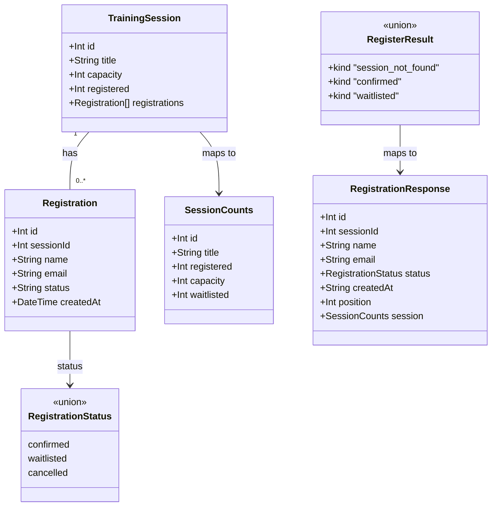

# Waitlist When a Training Session Is Full (LATC-87)

> Team copy of LATC-3. Prerequisite LATC-2 is implemented as **LATC-86** on `latc-86-register-for-session` (this branch's base), so the rebase note below is already satisfied. Commit prefix `[LATC-87]`.

> Source analysis: `spdd/analysis/LATC-87-202611231812-[Analysis]-waitlist-when-session-full.md` (carried over from LATC-3)
> **Prerequisite**: LATC-86 is implemented per `spdd/prompt/LATC-86-202611231811-[Feat]-api-register-for-training-session.md` (the `Registration` model, `registrationService.registerForSession`, `routes/registrations.ts`, `app/src/api.ts`, and the register form on `TrainingSessionCard`). This canvas is a **delta** on that code.
> Open questions from the analysis, resolved as defaults:
>
> - **W1 · 202 body**: the same shape as 201 (registration + session counts), plus `position`. Both bodies include `status`.
> - **W2 · Waitlisted count**: computed (never stored) and returned as `session.waitlisted` in POST responses. `GET /api/training-sessions` is **not** changed.
> - **W3 · Position**: derived, 1-based, ordered by `Registration.id` ascending among the session's `waitlisted` rows. Never stored.
> - **W4 · Message**: "You're on the waitlist for <title> (position N). You are not confirmed yet."
> - **W5 · Status storage**: a `String` column defaulting to `"confirmed"` and a TS union `confirmed | waitlisted | cancelled`. `cancelled` is declared but unused until LATC-4.

## Requirements

Capture demand for full sessions instead of turning employees away: when no seat is free, put the employee on an ordered waitlist and tell them clearly that they are waitlisted, not confirmed.

- Turn LATC-2's "full → 409 rejection" into "full → 202 waitlisted with position", on the same endpoint.
- Record each registration's status (`confirmed` or `waitlisted`) and keep the waitlist first-come-first-served.
- Keep `registered` meaning _confirmed seats only_, and keep `registered ≤ capacity`.
- Offer "Join Waitlist" on full session cards, and show the waitlisted message and position.
- **Out of scope**: promotion (LATC-5), cancellation (LATC-4), notifications (LATC-8), a maximum waitlist size, duplicate prevention.

## Entities

- **Changed**: `Registration` gains `status`. `SessionCounts` gains `waitlisted`. `RegisterResult` replaces `registered | session_full` with `confirmed | waitlisted`. The response gains `status` and an optional `position` (waitlisted only).
- **Unchanged**: `TrainingSession` fields, `RegistrationInput`, validation, and the `registered` counter semantics (confirmed only).
- No new tables. The waitlist is the set of `status = 'waitlisted'` rows.

## Approach

1. **API design**:
   - Same endpoint `POST /api/training-sessions/:id/registrations`: 201 when confirmed, 202 when waitlisted, plus the unchanged 400 and 404. **409 for a full session is removed.**
   - Both success bodies share one shape (W1), so the client handles them the same way and branches on `status`.
   - The waitlisted count is computed per request (W2). No second denormalised counter, so nothing can drift.

2. **Technical implementation**:
   - Prisma/SQLite. Add `status String @default("confirmed")` and an index on `[sessionId, status]` for the waitlist count and position queries. Existing rows become `confirmed` automatically on `prisma db push`.
   - Keep LATC-2's single transaction and atomic seat claim (`updateMany … registered < capacity`). Only the `count === 0` branch changes: it creates a `waitlisted` row instead of returning `session_full`.
   - Position = the number of `waitlisted` rows in the session with `id ≤ newId`, computed **inside the same transaction** after the insert. SQLite serialises write transactions, so concurrent joins get contiguous positions.
   - Error handling is unchanged: result union, a `switch` in the route, and `try/catch` with a generic 500. Still no reliance on the `app.ts` global handler.

3. **Business logic**:
   - Seat-or-wait in one transaction: claim → `confirmed`, otherwise → `waitlisted`. `registered` is never touched on the waitlist path.
   - Status values are restricted through a typed constant (`REGISTRATION_STATUS`) in the service. Raw strings are not scattered around the code.
   - Validation and normalisation are unchanged from LATC-2.

4. **Frontend**:
   - Card: when `isFull`, the action button reads **"Join Waitlist"** (enabled) instead of LATC-2's disabled button. The same form is reused, with the submit label "Join waitlist".
   - On 201: LATC-2's confirmation and count update. On 202: the W4 message, the "Your status: Waitlisted (position N)" line, and "N on waitlist" from `session.waitlisted`. `registered` stays unchanged.

5. **Risks**:
   - The LATC-2 tests asserting "full → 409" must be **changed** to "full → 202". This is expected, so don't keep both.
   - SQLite lock contention in the concurrency test: keep the LATC-2 transaction timeouts and a small test (capacity 2, 6 parallel requests).

## Structure

### Inheritance Relationships

1. `RegistrationStatus` is a string-literal union derived from the `REGISTRATION_STATUS` constant object (`as const`).
2. `RegisterResult` is a discriminated union on `kind`. `confirmed` and `waitlisted` carry `registration` and `session`, and `waitlisted` also carries `position`.
3. No class hierarchy and no custom exceptions, as in LATC-2.

### Dependencies

1. `routes/registrations.ts` calls `validateRegistrationInput` and `registerForSession` (`services/registrationService.ts`).
2. `registrationService` calls `lib/prisma` (transaction, `trainingSession`, `registration`).
3. `registrationService` has internal helpers `waitlistPosition(tx, sessionId, registrationId)` and `sessionCounts(tx, sessionId)`.
4. `TrainingSessionCard.tsx` calls `api.registerForSession` and reads `RegistrationResponse.status`, `.position` and `.session.waitlisted`.

### Layered Architecture

1. **Route layer**: unchanged parsing and validation. The `switch` maps `confirmed` to 201 and `waitlisted` to 202. The `session_full` case is removed.
2. **Service layer**: the seat-or-wait decision, status assignment, position and waitlisted-count derivation, all inside one transaction.
3. **Data layer**: the `Registration.status` column with a default, and the `[sessionId, status]` index.
4. **Client layer**: `api.ts` already treats any `res.ok` as success, so 202 is `ok`. Only the types change.
5. **UI layer**: card state adds `waitlisted` and `myPosition`. The button label and enabled state depend on `isFull`.
6. **Error handling**: per route, as in LATC-2.

## Operations

Test-first: update or add tests, see them fail, then implement.

### 1. Update Schema - `api/prisma/schema.prisma`

1. In `Registration`, add `status String @default("confirmed")` with the comment `// confirmed | waitlisted | cancelled`.
2. Add `@@index([sessionId, status])`, keeping the existing `@@index([sessionId])`.
3. Run `prisma db push` and `prisma generate`. Existing rows get `confirmed`.
4. Done when the push succeeds without data-loss prompts and `make reset-db` still seeds.

### 2. Update Integration Tests - `api/tests/integration/registrations.test.ts`

1. **Change** the "full session → 409" test to: capacity 1, registered 1 → **202**, body `status: 'waitlisted'`, `position: 1`, `session.registered === 1`, `session.waitlisted === 1`. The DB row has `status === 'waitlisted'`.
2. **Change** the 201 test to also assert `status: 'confirmed'`, `session.waitlisted === 0`, and the DB row `status === 'confirmed'`.
3. **Add** positions: on a full session, three sequential posts get `position` 1, 2, 3.
4. **Add** a separate count: after 1 confirmed and 2 waitlisted on capacity 1, the session row has `registered === 1`, and the last response has `session.waitlisted === 2`.
5. **Change** concurrency: capacity 2, 6 parallel posts give exactly two 201s and four 202s. The positions of the 202s, sorted, are `[1,2,3,4]`. The DB has `registered === 2`, 2 confirmed rows and 4 waitlisted rows.
6. **Add** capacity 0: the first post returns 202 with position 1.
7. 400, 404 and invalid-id tests are unchanged.

### 3. Update Service - `api/src/services/registrationService.ts`

1. Add constants and types:
   - `export const REGISTRATION_STATUS = { confirmed: 'confirmed', waitlisted: 'waitlisted', cancelled: 'cancelled' } as const`
   - `export type RegistrationStatus = (typeof REGISTRATION_STATUS)[keyof typeof REGISTRATION_STATUS]`
2. Extend the types:
   - `RegistrationDetails` gets `status: RegistrationStatus`.
   - `SessionCounts` gets `waitlisted: number`.
   - `RegisterResult = { kind: 'session_not_found' } | { kind: 'confirmed'; registration; session } | { kind: 'waitlisted'; registration; position: number; session }`.
3. `type Tx = Parameters<Parameters<typeof prisma.$transaction>[0]>[0]`.
4. Helper `waitlistPosition(tx: Tx, sessionId: number, registrationId: number): Promise<number>` returns `tx.registration.count({ where: { sessionId, status: 'waitlisted', id: { lte: registrationId } } })`.
5. Helper `sessionCounts(tx: Tx, sessionId: number): Promise<SessionCounts>` runs `findUniqueOrThrow` on the session plus `tx.registration.count({ where: { sessionId, status: 'waitlisted' } })`, and returns `{ id, title, registered, capacity, waitlisted }`.
6. Helper `details(row): RegistrationDetails` maps a Prisma row, with a narrow cast `row.status as RegistrationStatus`.
7. `registerForSession(sessionId, input)` keeps the LATC-2 transaction and timeouts:
   - Session missing → `{ kind: 'session_not_found' }`.
   - `claimed = updateMany(... registered < capacity → increment)`.
   - If `claimed.count === 0`:
     - `reg = create({ data: { sessionId, name, email, status: 'waitlisted' } })`.
     - Return `{ kind: 'waitlisted', registration: details(reg), position: await waitlistPosition(tx, sessionId, reg.id), session: await sessionCounts(tx, sessionId) }`.
   - Otherwise:
     - `reg = create({ data: { …, status: 'confirmed' } })`.
     - Return `{ kind: 'confirmed', registration: details(reg), session: await sessionCounts(tx, sessionId) }`.
   - Comment why the waitlist path doesn't touch `registered`.
8. Delete the `session_full` variant and any code that produces it.

### 4. Update Route - `api/src/routes/registrations.ts`

1. `switch (result.kind)`:
   - `session_not_found` → 404 (unchanged).
   - `confirmed` → `res.status(201).json({ ...result.registration, session: result.session })`.
   - `waitlisted` → `res.status(202).json({ ...result.registration, position: result.position, session: result.session })`.
2. Remove the `session_full` → 409 case. TypeScript's exhaustive switch must compile with no default branch for the result kinds.

### 5. Update Unit Tests - `api/tests/unit/registrationService.test.ts`

1. Validation tests are unchanged. Add an assertion that `REGISTRATION_STATUS` contains exactly `confirmed`, `waitlisted` and `cancelled`.

### 6. Update Frontend Types - `app/src/types/index.ts`

1. Add `export type RegistrationStatus = 'confirmed' | 'waitlisted' | 'cancelled'`.
2. `RegistrationResponse` gets `status: RegistrationStatus` and `position?: number`. `session` gets `waitlisted: number`.

### 7. Update Component - `app/src/components/TrainingSessionCard.tsx`

1. New state: `waitlisted: number | null` (unknown until the first response), `myPosition: number | null`.
2. Button: label `isFull ? 'Join Waitlist' : 'Register'`. It is **never disabled for being full**, only while submitting. The form's submit label is `isFull ? 'Join waitlist' : 'Confirm registration'`.
3. `handleSubmit`, on `ok`:
   - Always set `registered = data.session.registered` and `waitlisted = data.session.waitlisted`.
   - `status === 'waitlisted'`: set `myPosition = data.position ?? null` and the confirmation to the W4 text.
   - `status === 'confirmed'`: LATC-2 confirmation text.
   - Close the form and clear the fields.
4. Remove LATC-2's "409 → set registered = capacity" handling (409 no longer occurs for full sessions).
5. Render:
   - When `myPosition !== null`: `Your status: Waitlisted (position {myPosition})`.
   - When `waitlisted` is greater than 0: `{waitlisted} on waitlist` next to the capacity line.
   - Confirmation with `role="status"`, errors with `role="alert"` (unchanged).
6. CSS: a modifier for the waitlist button and status line in `TrainingSessionCard.css`, following the `session-card__*` naming.

### 8. Verify

1. `make test`, `make lint` and `make format-check` are clean.
2. Manual: `make dev`. Fill a small session, then the card shows "Join Waitlist". Joining shows the W4 message and "Waitlisted (position 1)". A second join gets position 2, the count reads "2 on waitlist", and `registered` doesn't change.
3. `make reset-db` afterwards.

## Norms

1. **Typing**: no `any`. Status values come only from `REGISTRATION_STATUS` and the `RegistrationStatus` union. Casts are allowed only when mapping Prisma rows (`status as RegistrationStatus`).
2. **Layering**: route → service → `lib/prisma`. The route has no Prisma import. Derived values (position, waitlisted count) are computed in the service, never in the route or UI.
3. **Error handling**: expected outcomes are union variants and the route switch is exhaustive. Unexpected errors are handled with `try/catch`, `console.error('Error creating registration:', error)` and a generic 500. Error body `{ error, details? }`.
4. **Data integrity**: every write for one registration (claim, insert, derived reads) happens in a single `$transaction`. The waitlist path never changes `registered`.
5. **Validation**: unchanged from LATC-2 (pure function, message array, trim and lower-case the email).
6. **Logging**: errors only. Don't log names or emails.
7. **Testing**: Keep the 127.0.0.1-bound test server from LATC-86 (no `request(app)`). TDD. Change the superseded LATC-2 assertions instead of duplicating them. Tests create their own sessions and clean them up in `afterAll`.
8. **Style and docs**: Prettier, commits prefixed `[LATC-87]`. Short comments only for non-obvious choices (derived position, the waitlist not touching the counter).

## Safeguards

1. **Functional constraints**: a full session always yields 202 plus a `waitlisted` row. A non-full session yields 201 plus a `confirmed` row. No request to a full session returns 409.
2. **Performance constraints**: at most 6 queries per registration transaction. Position and count queries use the `[sessionId, status]` index. The `GET` list endpoint is unchanged.
3. **Security constraints**: no raw SQL. No stack traces or Prisma messages in responses. The request still accepts only `name` and `email`, and a client-supplied `status` or `position` is ignored.
4. **Integration constraints**:
   - LATC-1 endpoints and tests stay green.
   - LATC-2 behaviour is unchanged except for the deliberate supersessions (409 → 202, the disabled button → "Join Waitlist", `status` added to the 201 body).
   - Existing registrations default to `confirmed`.
5. **Business rule constraints**:
   - `registered ≤ capacity` always.
   - `registered` equals the count of `confirmed` rows for the session.
   - Waitlist positions are contiguous 1…N in id order, with no duplicates under concurrency (verified with capacity 2 and 6 parallel requests).
6. **Exception handling constraints**: each non-2xx response carries a clear `error` message. Outcomes are classified by `kind`. Nothing internal is exposed. Every unexpected error is caught in the route.
7. **Technical constraints**: Prisma + SQLite with `prisma db push` (no migrations). No new dependencies. No stored `position` column and no stored waitlist counter.
8. **Data constraints**: `status` ∈ {`confirmed`, `waitlisted`} for rows written by this story (`cancelled` is reserved). The status is non-null with default `confirmed`. Name and email rules are as in LATC-2.
9. **API constraints**: `POST /api/training-sessions/:id/registrations` returns:
   - `201` with `{ id, sessionId, name, email, status: 'confirmed', createdAt, session: { id, title, registered, capacity, waitlisted } }`
   - `202` with `{ id, sessionId, name, email, status: 'waitlisted', createdAt, position, session: { … } }`
   - `400`, `404` and `500` as in LATC-2
