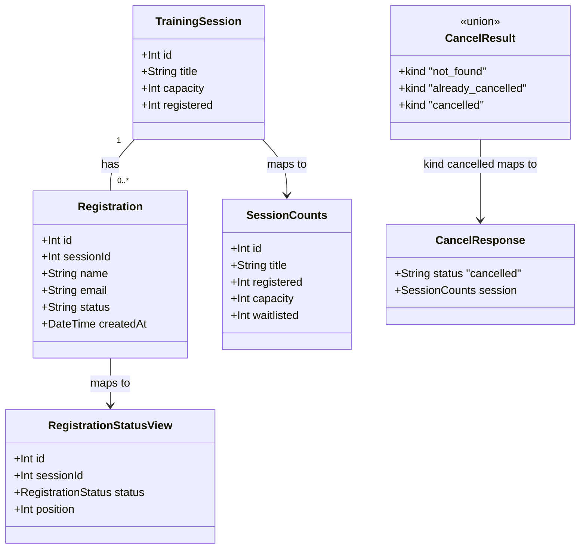

# Cancel a Registration (LATC-88)

> Team copy of **LATC-4**. Source analysis: `spdd/analysis/LATC-88-202611231812-[Analysis]-cancel-registration.md`
> **Base**: `latc-87-waitlist-when-full`. LATC-86 (registration) and LATC-87 (waitlist) are implemented. This canvas is a delta on that code.
> Open questions resolved as defaults:
>
> - **C1 · Promotion**: not implemented. The seat release lives in one service step, which LATC-89 replaces with promote-or-release.
> - **C2 · Body**: `200 { status: 'cancelled', session: SessionCounts }`.
> - **C3 · Waitlisted cancel**: allowed. No counter change.
> - **C4 · Mismatch**: 404 "Registration not found".
> - **C5 · My registration**: `{ registrationId }` per session in `localStorage`, plus `GET …/registrations/:registrationId` (no PII).

## Requirements

Let an employee release a place they no longer need, so the seat count stays truthful and the seat can later be handed to someone waiting.

- Implement cancellation by registration id, scoped to its session.
- Release exactly one confirmed seat per confirmed cancellation, atomically. Never go below zero.
- Let the browser that registered find its registration again after a reload, and cancel it with a confirmation prompt.
- **Out of scope**: waitlist promotion (LATC-89), notifications, organiser cancellation, authentication.

## Entities

- **No schema change.** `status` already allows `cancelled`.
- **New**: `CancelResult`, `CancelResponse`, `RegistrationStatusView` (`position` is `number | null`), `RegistrationLookupResult`.
- **Unchanged**: the POST contract, `RegisterResult`, `SessionCounts`.

## Approach

1. **API design**:
   - `DELETE /api/training-sessions/:id/registrations/:registrationId` returns `200 { status: 'cancelled', session }`, `400` (invalid ids), `404` (unknown or mismatched) or `409` (already cancelled).
   - `GET` on the same path returns `200 { id, sessionId, status, position | null }` or `400`/`404`. It contains no name or email.
2. **Technical implementation**:
   - One `prisma.$transaction` with LATC-86's timeouts.
   - Conditional transition: `updateMany({ where: { id, status: loaded.status }, data: { status: 'cancelled' } })`. A count of 0 → `already_cancelled`.
   - Seat release: `updateMany({ where: { id: sessionId, registered: { gt: 0 } }, data: { registered: { decrement: 1 } } })`, only when the loaded status was `confirmed`. It lives in one internal function, `releaseSeat(tx, sessionId)`, which is LATC-89's extension point.
   - Error handling as in LATC-86/87: result union → exhaustive switch, route `try/catch` → 500.
3. **Business logic**: `confirmed → cancelled` releases a seat. `waitlisted → cancelled` only leaves the queue. `cancelled` is terminal.
4. **Frontend**:
   - `api.ts` gains a private `request<T>` helper, plus `cancelRegistration` and `getRegistration`.
   - The card stores the id on a 201/202, restores status on mount, and shows "Cancel Registration" for `confirmed`/`waitlisted`.
   - On confirm it shows "Your registration has been cancelled", updates the counts from the response, and shows a disabled "Cancelled".

## Structure

### Inheritance Relationships

1. `CancelResult` is a discriminated union on `kind`. `cancelled` carries `registration: RegistrationDetails` and `session: SessionCounts`.
2. `RegistrationLookupResult` is `{ kind: 'not_found' } | { kind: 'found'; view: RegistrationStatusView }`.
3. No classes and no custom exceptions.

### Dependencies

1. `routes/registrations.ts`: `DELETE /:registrationId` calls `cancelRegistration`; `GET /:registrationId` calls `getRegistrationStatus`.
2. `cancelRegistration` calls `prisma.$transaction`, `releaseSeat`, `sessionCounts` and `details`.
3. `getRegistrationStatus` calls `prisma.registration.findFirst` and `waitlistPosition`. Its parameter type widens to `Tx | typeof prisma`.
4. `TrainingSessionCard.tsx` calls `api.cancelRegistration`, `api.getRegistration` and `localStorage`.

### Layered Architecture

1. **Route**: parse ids, call the service, map `kind` → status. No Prisma.
2. **Service**: transaction, conditional transition, seat release, lookup.
3. **Data**: the existing `status` and `[sessionId, status]` index.
4. **Client**: `api.ts` wrappers returning `ApiResult<T>`.
5. **UI**: card state `myRegistrationId`, `myStatus`, `myPosition`, `cancelling`.

## Operations

Test-first: write the tests, see them fail, then implement.

### 1. Integration Tests - `api/tests/integration/registrations.test.ts` (new `describe('cancel')`)

1. Helpers:
   - `seed(capacity, confirmed, waitlisted)` creates rows sequentially and returns `{ sessionId, confirmedIds, waitlistedIds }`.
   - `assertCounterConsistent(sessionId)` checks `registered === count(confirmed)`.
2. Cases:
   - Cancel confirmed (`seed(2,2,0)`) → 200 `{ status: 'cancelled' }`, `session.registered === 1`, row `cancelled`, counter consistent.
   - Cancel confirmed with a waitlist (`seed(1,1,1)`) → 200, `session.registered === 0`, the waitlisted row is still `waitlisted` (no promotion in LATC-88).
   - Cancel waitlisted (`seed(1,1,2)`) → 200, `registered` stays 1, and the GET of the second waitlisted id shows `position === 1`.
   - Already cancelled → 409 `'Registration is already cancelled'`, nothing changes.
   - Unknown → 404. Another session's id → 404, and its row is untouched.
   - Invalid ids → 400 `'Invalid session ID'` / `'Invalid registration ID'`.
   - Concurrent double cancel of the same id → one 200 and one 409, `registered` decremented exactly once.
   - GET: waitlisted → `{ id, sessionId, status: 'waitlisted', position: 1 }`; cancelled → `position: null`; no `name`/`email`; unknown or mismatched → 404; invalid → 400.

### 2. Unit Tests - `api/tests/unit/registrationService.test.ts`

1. Mock `lib/prisma` with `$transaction` invoking the callback on a mock `tx`.
2. `cancelRegistration`:
   - not found → no writes.
   - already cancelled → no writes.
   - waitlisted → one registration `updateMany`, no session write.
   - confirmed → the session `updateMany` is called with `registered: { gt: 0 }` and `decrement: 1`.

### 3. Service - `api/src/services/registrationService.ts`

1. Add the types `CancelResult`, `RegistrationStatusView` and `RegistrationLookupResult`.
2. Widen `waitlistPosition`'s first parameter to `Tx | typeof prisma`.
3. Add `async function releaseSeat(tx: Tx, sessionId: number): Promise<void>`. It runs the guarded decrement. Comment: LATC-89 hands the seat to the waitlist head here.
4. `export async function cancelRegistration(sessionId: number, registrationId: number): Promise<CancelResult>`, inside a transaction:
   - Find the row with `{ id: registrationId, sessionId }`. Missing → `not_found`.
   - Status `cancelled` → `already_cancelled`.
   - Conditional `updateMany`. A count of 0 → `already_cancelled`.
   - If the old status was `confirmed`, call `releaseSeat`.
   - Return `{ kind: 'cancelled', registration: details({...reg, status: cancelled}), session: await sessionCounts(tx, sessionId) }`.
5. `export async function getRegistrationStatus(sessionId: number, registrationId: number): Promise<RegistrationLookupResult>`:
   - `findFirst` selecting `id, sessionId, status`. Missing → `not_found`.
   - Position comes from `waitlistPosition` when the status is `waitlisted`, otherwise it's `null`.

### 4. Routes - `api/src/routes/registrations.ts`

1. `parseIds(req, res)` sends a 400 with `'Invalid session ID'` (checked first) or `'Invalid registration ID'`, and returns `null`.
2. `DELETE /:registrationId`:
   - `not_found` → 404 `{ error: 'Registration not found' }`
   - `already_cancelled` → 409 `{ error: 'Registration is already cancelled' }`
   - `cancelled` → 200 `{ status: 'cancelled', session }`
   - catch → `console.error('Error cancelling registration:', error)`, then 500 `{ error: 'Failed to cancel registration' }`
3. `GET /:registrationId`:
   - `not_found` → 404
   - `found` → 200 `view`
   - catch → 500 `{ error: 'Failed to fetch registration' }`

### 5. Frontend Types - `app/src/types/index.ts`

1. `CancelResponse { status: 'cancelled'; session: RegistrationResponse['session'] }`.
2. `RegistrationStatusView { id; sessionId; status: RegistrationStatus; position: number | null }`.

### 6. HTTP Client - `app/src/api.ts`

1. Extract a private `request<T>(url, init, fallback)`. `registerForSession` uses it, with no behaviour change.
2. `cancelRegistration(sessionId, registrationId)` → DELETE, fallback 'Cancellation failed'.
3. `getRegistration(sessionId, registrationId)` → GET, fallback 'Could not load registration'.

### 7. Component - `app/src/components/TrainingSessionCard.tsx`

1. Guarded storage helpers keyed `workshophub.registration.<sessionId>`.
2. On mount: restore `myRegistrationId`, `myStatus` and `myPosition` from `getRegistration`. A 404 clears the key.
3. On register success: save the id and set `myStatus`.
4. `handleCancel`:
   - `window.confirm('Are you sure you want to cancel your registration for <title>?')`.
   - On success: counts from `data.session`, `myStatus = 'cancelled'`, message 'Your registration has been cancelled'.
   - On a 409: `myStatus = 'cancelled'`.
5. Render:
   - "Your status: Confirmed" or "Waitlisted (position N)".
   - "Cancel Registration" for confirmed/waitlisted. The register button is hidden while you hold a registration.
   - A disabled "Cancelled" after cancelling.

### 8. Verify

1. Run `make test`, `make lint`, `make format-check` and `make reasons-lint`.

## Norms

1. **Typing**: no `any`. Statuses only from `REGISTRATION_STATUS`. Casts only when mapping Prisma rows and JSON.
2. **Layering**: route → service → `lib/prisma`. The seat release is a single service function.
3. **Error handling**: result unions with exhaustive switches. Route `try/catch` → generic 500. Body `{ error }`.
4. **Data integrity**: one transaction per cancellation, conditional status updates, and `registered` never below 0.
5. **Testing**: TDD. A 127.0.0.1-bound test server. Seed your own data, assert `registered === count(confirmed)`, clean up.
6. **Style**: Prettier. Commits prefixed `[LATC-88]`. Comments only for non-obvious choices (the seam, the conditional update).

## Safeguards

1. **Functional constraints**:
   - A confirmed cancel decrements `registered` by exactly 1.
   - A waitlisted cancel changes no counter.
   - No promotion happens in this story.
   - 400, 404 and 409 paths write nothing.
2. **Performance constraints**: at most 6 queries per cancel transaction. The lookup is ≤2 queries.
3. **Security constraints**: no raw SQL. The GET returns no name or email. Ids are always scoped by session. `localStorage` holds numeric ids only.
4. **Integration constraints**: the LATC-86/87 POST contract and tests are unchanged. `app.ts` is unchanged.
5. **Business rule constraints**: `registered === count(confirmed)` and `0 ≤ registered ≤ capacity`. `cancelled` is terminal.
6. **Exception handling constraints**: exact messages: 'Invalid session ID', 'Invalid registration ID', 'Registration not found', 'Registration is already cancelled', 'Failed to cancel registration', 'Failed to fetch registration'.
7. **Technical constraints**: no schema change. No new dependencies.
8. **Data constraints**: allowed transitions are `confirmed → cancelled` and `waitlisted → cancelled`.
9. **API constraints**:
   - `DELETE …/registrations/:registrationId` → `200 { status: 'cancelled', session: { id, title, registered, capacity, waitlisted } }` | 400 | 404 | 409 | 500.
   - `GET …/registrations/:registrationId` → `200 { id, sessionId, status, position }` | 400 | 404 | 500.
