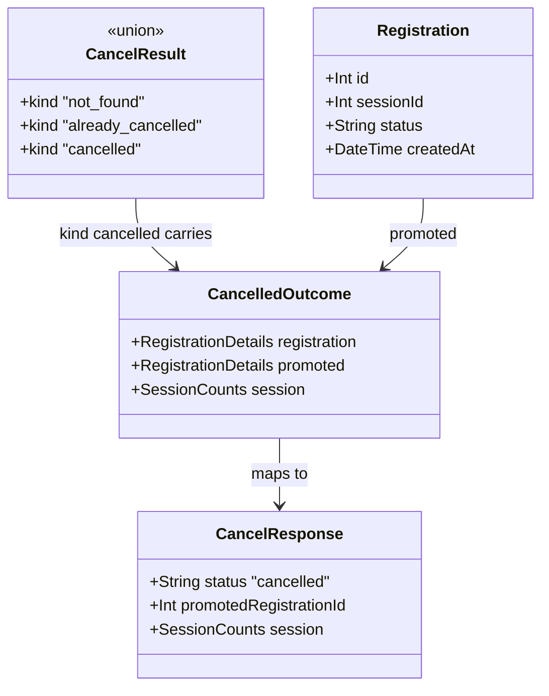

# Promote the First Waitlisted Employee After Cancellation (LATC-89)

> Team copy of **LATC-5**. Source analysis: `spdd/analysis/LATC-89-202611231815-[Analysis]-promote-waitlisted-after-cancellation.md`
> **Base**: `latc-88-cancel-registration`. Registration (LATC-86), waitlist (LATC-87) and cancellation (LATC-88) are implemented. This canvas is a **delta**: it replaces LATC-88's `releaseSeat` seam with promote-or-release and extends the cancel response.
> Defaults (carried over from the LATC-71 canvas):
>
> - **P3 · Notification**: not sent. A `// LATC-8` hook comment.
> - **P5 · Order**: the head is the lowest `id` among `waitlisted` rows of the same session. This matches LATC-87's `position`.
> - **P7 · Over capacity**: promote only if confirmed seats after the cancel are below capacity. Otherwise release.

## Requirements

Hand a freed confirmed seat straight to the first person waiting, in the same transaction as the cancellation, so no seat sits empty while there is demand and the queue stays first-come-first-served.

- Promote the waitlist head to `confirmed` whenever a **confirmed** cancellation frees a seat. With nobody waiting, release the seat as LATC-88 does.
- Keep `registered` exact: net zero on promotion, −1 without.
- Report `promotedRegistrationId` (id or `null`) in the cancel response, while the canceller still sees only the standard message.
- **Out of scope**: sending notifications (LATC-8), manual promotion by an organiser.

## Entities



- **Changed**: the `cancelled` variant of `CancelResult` gains `promoted: RegistrationDetails | null`. `CancelResponse` gains `promotedRegistrationId: number | null`.
- **Unchanged**: the schema, `RegistrationStatusView`, the POST contract, and every LATC-88 error path.

## Approach

1. **API design**: same `DELETE` endpoint. The 200 body becomes `{ status: 'cancelled', promotedRegistrationId, session }`. It's additive, so LATC-88 clients keep working.
2. **Technical implementation**:
   - Inside LATC-88's existing cancel transaction, the confirmed branch becomes: read the session → if `registered - 1 < capacity`, call `promoteNext(tx, sessionId)` → if that returns nothing, `releaseSeat`.
   - `promoteNext` picks the head with `findFirst` ordered by `id asc`, then runs a status-conditional `updateMany` (`waitlisted → confirmed`). If it loses a race (count 0), it retries once with the next head.
   - On promotion, `registered` isn't written at all (net zero).
3. **Business logic**: only a confirmed cancellation promotes. At most one promotion per cancellation. Concurrent cancels promote different people.
4. **Frontend**: no change to the canceller flow; `promotedRegistrationId` is never displayed. The promoted employee's card already restores status from LATC-88's GET, so after a refresh it shows "Your status: Confirmed". Only the `CancelResponse` type gains the field.

## Structure

### Inheritance Relationships

1. `CancelResult.cancelled` = `{ registration; promoted: RegistrationDetails | null; session }`.
2. No classes and no exceptions.

### Dependencies

1. `cancelRegistration` calls `promoteNext` (new), `releaseSeat` (LATC-88) and `sessionCounts`.
2. `routes/registrations.ts` maps `result.promoted?.id ?? null` to `promotedRegistrationId`.

### Layered Architecture

1. **Route**: shape the extra field only.
2. **Service**: head selection, conditional promotion, net-zero accounting.
3. **Data**: unchanged.
4. **UI**: unchanged apart from the type.

## Operations

Test-first.

### 1. Integration Tests - `api/tests/integration/registrations.test.ts`

1. **Change** LATC-88's "does not promote anyone" test into "promotes the first waitlisted registration and keeps registered unchanged" (`seed(1,1,2)`):
   - `promotedRegistrationId === waitlistedIds[0]`, `session.registered === 1`, `session.waitlisted === 1`.
   - First waitlisted row `confirmed`, second still `waitlisted`.
   - A second cancel of the promoted one promotes `waitlistedIds[1]`.
2. **Add**: confirmed cancel with an empty waitlist → `promotedRegistrationId: null`, `registered` −1.
3. **Add**: waitlisted cancel → `promotedRegistrationId: null`.
4. **Add**: over capacity (`seed(2,2,1)`, then set capacity 1) → `promotedRegistrationId: null`, `registered === 1`.
5. **Add**: concurrent cancels (`seed(2,2,2)`, cancel both confirmed in parallel) → two distinct `promotedRegistrationId`s equal to the `waitlistedIds` set, `registered === 2`, 0 waitlisted, counter consistent.
6. **Add**: after a promotion, the GET of the promoted id returns `status: 'confirmed'`, `position: null` (AC2 at the API level).

### 2. Unit Tests - `api/tests/unit/registrationService.test.ts`

1. Confirmed cancel with a head → two registration `updateMany` calls (cancel and promote), **no** session `updateMany`, `promoted.id` is the head.
2. Confirmed cancel with no head → the session decrement is called (unchanged LATC-88 behaviour).

### 3. Service - `api/src/services/registrationService.ts`

1. `CancelResult.cancelled` gains `promoted: RegistrationDetails | null`.
2. Add `async function promoteNext(tx: Tx, sessionId: number): Promise<RegistrationDetails | null>`. At most 2 attempts:
   - Find the head (`waitlisted`, `orderBy id asc`). None → `null`.
   - `updateMany({ where: { id: head.id, status: waitlisted }, data: { status: confirmed } })`. A count of 1 → return `details({ ...head, status: confirmed })`.
   - After 2 attempts → `null`.
3. In `cancelRegistration`, replace `if confirmed → releaseSeat` with:
   ```
   let promoted = null
   if (old status === confirmed) {
     session = findUniqueOrThrow
     if (session.registered - 1 < session.capacity) promoted = await promoteNext(tx, sessionId)
     if (promoted === null) await releaseSeat(tx, sessionId)
   }
   // LATC-8: notify promoted employee here (out of scope for LATC-89)
   ```
   Return `promoted` in the `cancelled` result.

### 4. Route - `api/src/routes/registrations.ts`

1. The 200 body is `{ status: 'cancelled', promotedRegistrationId: result.promoted?.id ?? null, session: result.session }`.

### 5. Frontend Types - `app/src/types/index.ts`

1. `CancelResponse` gains `promotedRegistrationId: number | null`.

### 6. Component - `app/src/components/TrainingSessionCard.tsx`

1. No behaviour change. Add a comment at the cancel success branch: `promotedRegistrationId` is deliberately not shown, because promotion is invisible to the canceller.

### 7. Verify

1. `make test`, `make lint`, `make format-check` and `make reasons-lint` pass. Run the integration file 5 times to check the concurrency test is stable.

## Norms

1. **Typing**: no `any`. Statuses only from `REGISTRATION_STATUS`.
2. **Layering**: promotion lives only in the service. The route only shapes the field.
3. **Error handling**: unchanged from LATC-88 (unions, exhaustive switch, generic 500).
4. **Data integrity**: one transaction. Status-conditional updates. Promotion never writes `registered`.
5. **Testing**: TDD on the 127.0.0.1-bound server. Assert `registered === count(confirmed)` after every mutation. Change LATC-88's superseded "no promotion" test instead of keeping it.
6. **Style**: Prettier. Commits prefixed `[LATC-89]`. Comments for the id ordering, the retry and the LATC-8 hook.

## Safeguards

1. **Functional constraints**:
   - A confirmed cancel with ≥1 waitlisted promotes exactly the lowest-id waitlisted registration in that session, and `registered` is unchanged.
   - With an empty waitlist it decrements by 1.
   - A waitlisted cancel promotes nobody.
2. **Performance constraints**: at most 8 queries per cancel transaction normally, and 10 in the worst case, when `promoteNext` loses a race and retries (an extra head lookup and promote). Head selection uses the `[sessionId, status]` index.
3. **Security constraints**: no raw SQL. The promoted registration's PII is never returned; only the id is.
4. **Integration constraints**: LATC-86/87/88 contracts are unchanged except for the additive `promotedRegistrationId`. Every LATC-88 error message is unchanged.
5. **Business rule constraints**:
   - `registered === count(confirmed)` and ≤ capacity after every operation.
   - At most one promotion per cancellation.
   - Concurrent cancels promote distinct registrations.
6. **Exception handling constraints**: same messages as LATC-88. No new error paths.
7. **Technical constraints**: no schema change, no new dependencies.
8. **Data constraints**: the new transition `waitlisted → confirmed` happens only through promotion.
9. **API constraints**: `DELETE …/registrations/:registrationId` returns `200 { status: 'cancelled', promotedRegistrationId: number | null, session }`, with 400/404/409/500 as in LATC-88.
