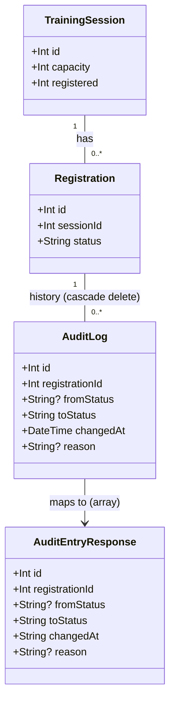

# Audit Log for Registration State Changes (LATC-9)

> Source: Jira LATC-9 (working copy LATC-129), analysis `spdd/analysis/LATC-9-202611241055-[Analysis]-registration-audit-log.md`.
> Status: the analysis found this story already implemented on `main`. This canvas records the design as built, so Operations are verify-and-keep tasks. Change code only if a check fails.
>
> **Defaults chosen for the open questions (from the analysis recommendations):**
> - Response shape: a bare JSON array of audit entries (no wrapper object).
> - Ordering: `changedAt` ascending, ties broken by `id` ascending.
> - `reason`: a short label for the transition (`registered`, `waitlisted`, `promoted`, `cancelled`), not free text. No actor data.
> - Cancelled registrations are not listed on the organiser registrations page. This is accepted because the AC only covers that page. No UI change.
> - Audit is written by an explicit service call inside the same transaction, not by Prisma middleware or a DB trigger.
> - Re-cancelling a cancelled registration changes nothing, so it writes no audit entry.

## Requirements
Give organisers a chronological, immutable history of every status transition for a registration (initial registration, waitlisting, promotion, cancellation). Expose it read-only at `GET /api/training-sessions/:id/registrations/:registrationId/audit`. Each audit entry is written in the same transaction as the status change. Out of scope: actor tracking, an audit UI, rotation or archival.

## Entities

## Approach
1. Persistence:
   - `AuditLog` Prisma model (table `audit_logs`), indexed on `registrationId`, applied with `prisma db push`.
   - Rows are append-only. No update or delete code path exists.
2. Write path:
   - The private helper `recordTransition(tx, registrationId, from, to, reason)` in `registrationService.ts` takes the caller's transaction client, so the audit insert commits or rolls back with the status change.
   - It is called at all four transition points: register→confirmed, register→waitlisted, cancel (any→cancelled), promote (waitlisted→confirmed).
3. Read path:
   - The route parses and validates IDs (400 if not numeric). The service `getAuditHistory(sessionId, registrationId)` returns null when the registration is not in that session. The route maps null to 404 and otherwise returns 200 with an array ordered by `changedAt, id`.
   - Errors are handled per route with try/catch and a 500 response `{ error }`, as in the reference route.
4. Verification:
   - Run the existing integration tests (`audit.test.ts`, `audit-atomicity.test.ts`, `promotion-atomicity.test.ts`) and the sensors. A failure caused by stale DB data blocks the run; never reset the DB.

## Structure

### Inheritance Relationships
1. No class hierarchy. The modules are functional TypeScript; the Prisma types come from `@prisma/client`.

### Dependencies
1. `routes/registrations.ts` calls `services/registrationService.getAuditHistory`.
2. `registrationService` depends on `lib/prisma.ts` (shared client) and `Prisma.TransactionClient`.
3. `registerForSession`, `cancelRegistration` and the promotion step call `recordTransition` inside `prisma.$transaction`.

### Layered Architecture
1. Route layer: parse params, return 400/404/200/500. No Prisma.
2. Service layer: business rules, transactions, all Prisma access, audit writes and reads.
3. Data layer: `lib/prisma.ts` and SQLite through Prisma.
4. Error handling: try/catch per route returning `{ error }` JSON.

## Operations

### 1. Verify Prisma model - AuditLog
1. Responsibility: store one status transition.
2. Attributes: `id` Int autoincrement PK; `registrationId` Int FK with cascade delete; `fromStatus` String? (null for the initial transition); `toStatus` String; `changedAt` DateTime default now(); `reason` String?.
3. Constraints: `@@index([registrationId])`, `@@map("audit_logs")`; `Registration.auditLogs AuditLog[]`.
4. Done when: the schema in `api/prisma/schema.prisma` matches this. No change expected.

### 2. Verify service helper - recordTransition
1. Signature: `recordTransition(tx: Prisma.TransactionClient, registrationId: number, fromStatus: RegistrationStatus | null, toStatus: RegistrationStatus, reason: string): Promise<void>`.
2. Logic: `tx.auditLog.create({ data: { registrationId, fromStatus, toStatus, reason } })`.
3. Call sites, all inside the same `$transaction` as the status write:
   - new confirmed registration: `(null, 'confirmed', 'registered')`
   - new waitlisted registration: `(null, 'waitlisted', 'waitlisted')`
   - cancellation, after a conditional update that matched a row: `(previousStatus, 'cancelled', 'cancelled')`
   - promotion: `('waitlisted', 'confirmed', 'promoted')`
4. Done when: every status write has exactly one audit write next to it, and a no-op re-cancel writes nothing.

### 3. Verify service read - getAuditHistory
1. Signature: `getAuditHistory(sessionId: number, registrationId: number): Promise<AuditLog[] | null>`.
2. Logic: look up the registration by `{ id: registrationId, sessionId }`. If not found, return null. Otherwise return `auditLog.findMany({ where: { registrationId }, orderBy: [{ changedAt: 'asc' }, { id: 'asc' }] })`.
3. Done when: a registration from another session returns null, and ordering is deterministic.

### 4. Verify route - GET /:registrationId/audit
1. Location: `api/src/routes/registrations.ts`, mounted under `/api/training-sessions/:id/registrations`.
2. Logic: parse `id` and `registrationId` as integers. If either is invalid, return 400 `{ error }`. Call `getAuditHistory`. If it returns null, return 404 `{ error: 'Registration not found' }`. Otherwise return 200 with the array. Any exception returns 500 `{ error: 'Failed to fetch audit history' }`.
3. Constraints: no PUT, PATCH or DELETE handlers for audit.

### 5. Verify tests and sensors
1. `api/tests/integration/audit.test.ts` covers ordering, all transitions, 404 (missing and cross-session), 400, and immutability (PUT/PATCH/DELETE do not change rows).
2. `audit-atomicity.test.ts` and `promotion-atomicity.test.ts` cover rollback together with the status change.
3. Run `make test`, `make lint`, `make format-check` and `bash scripts/reasons-lint.sh`. All must pass, and the tests must not be weakened.

### 6. Verify organiser registrations page shows registration ID
1. Location: `SessionDetailPage` (app), the organiser registrations page from WH-6.
2. Logic: the page renders an ID column showing the registration ID for each active registration, so the organiser can identify the ID used by the audit endpoint (AC1).
3. Done when: the ID column is present and an existing app test or a manual check confirms it. No change expected.

## Norms
1. TypeScript strict, no `any` (AGENT.md). Use `Prisma.TransactionClient` and the domain status types.
2. No Prisma in routes. All DB access goes through services using the shared `lib/prisma.ts` client.
3. Error handling: routes catch, log with `console.error`, and return `{ error: string }` with 400/404/500. Internal details never go to the client.
4. Validation: route params go through `parseInt` and a NaN check before the service call.
5. Tests: integration tests share the dev DB and must clean up the rows they create.
6. Commits are prefixed `[LATC-9]`. Formatting is Prettier and ESLint clean.

## Safeguards
1. Functional: every registration status change creates exactly one audit row in the same transaction. If the transaction fails, neither row persists.
2. Immutability: the API has no update or delete for audit entries. Only cascade deletion of the registration removes them.
3. API contract: 200 returns a bare array ordered by `changedAt` then `id`; 404 for a missing or cross-session registration; 400 for non-numeric IDs; 500 on unexpected errors.
4. Data: the first entry of any history has `fromStatus` null. `toStatus` is one of confirmed, waitlisted or cancelled.
5. Scope: no actor or identity fields, no UI page, no rotation or archival.
6. Compatibility: existing registration endpoints and response shapes stay unchanged.
7. Process: never reset the DB to make tests pass. Never edit sensors or weaken tests.
8. Security: error responses contain no stack traces or SQL details.
9. Organiser view: the organiser registrations page keeps showing the registration ID for each active registration, which the audit endpoint needs.
