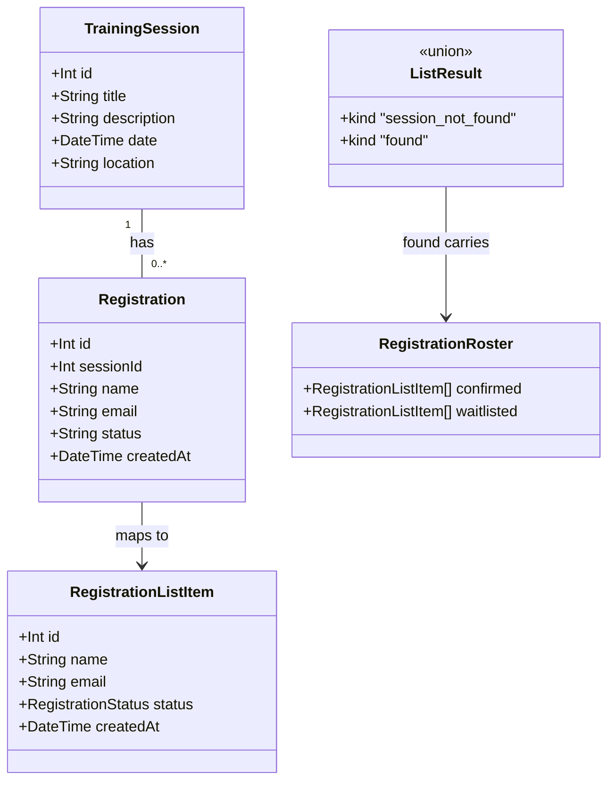

# Organiser Views Registrations for a Session (LATC-90)

> Team copy of **LATC-6**. Source analysis: `spdd/analysis/LATC-90-202611231816-[Analysis]-organiser-view-registrations.md`
> **Base**: `latc-89-promote-waitlisted` (registration, waitlist, cancellation and promotion are implemented). This canvas is a delta.
> Defaults: hand-rolled router (D1), one roster query (D2), two parallel client fetches (D3), "No registrations yet" only when both lists are empty (D4), the card title is the link (D5).

## Requirements

Give organisers a per-session view of who is attending and who is waiting, so they can prepare delivery. No login is needed, matching the training model.

- Expose a session's non-cancelled registrations, grouped into confirmed and waitlisted.
- Add a session detail page, reachable from the list, with session info and the roster.
- **Out of scope**: auth/roles, export, editing or cancelling from this view, pagination.

## Entities

- **No schema change.**
- **New**: `RegistrationListItem`, `RegistrationRoster`, `ListResult` (API). Mirrored in `app/src/types`.

## Approach

1. **API design**: `GET /api/training-sessions/:id/registrations` returns `200 { confirmed: RegistrationListItem[], waitlisted: RegistrationListItem[] }`, `400` (invalid id) or `404` (`'Training session not found'`). Both arrays are ordered by id ascending (queue order).
2. **Technical implementation**:
   - The service checks the session exists, then runs one `findMany({ where: { sessionId, status: { in: [confirmed, waitlisted] } }, orderBy: { id: 'asc' }, select: {...} })` and splits the result.
   - The route uses the same `parseId`/switch/try-catch pattern.
3. **Frontend**:
   - `router.ts` (`navigate`, `usePath`, `Link`) uses `history.pushState` plus a `workshophub:navigate` event and `popstate`.
   - `App.tsx` picks a page from the path: `/sessions/:id` → `SessionDetailPage`, otherwise the list.
   - `SessionDetailPage` loads the session and the roster in parallel and renders the info, the "Registrations" section, two subsections with counts, and the empty or error states.
   - The card title becomes a `Link` to `/sessions/:id`.

## Structure

### Inheritance Relationships

1. `ListResult` = `{ kind: 'session_not_found' } | { kind: 'found'; roster: RegistrationRoster }`.
2. No classes.

### Dependencies

1. `routes/registrations.ts` `GET /` calls `listRegistrations`.
2. `listRegistrations` calls `prisma.trainingSession.findUnique` and `prisma.registration.findMany`.
3. `SessionDetailPage` calls `api.getSession` and `api.listRegistrations`.
4. `TrainingSessionCard` calls `router.Link`. `App` calls `router.usePath`.

### Layered Architecture

1. **Route**: parse the id, switch on `kind`.
2. **Service**: the existence check, the filter, the grouping.
3. **Client**: `api.ts` gets `getSession(id)` and `listRegistrations(id)`.
4. **UI**: router, `App` page switch, detail page, card link.

## Operations

Test-first.

### 1. Integration Tests - `api/tests/integration/registrations.test.ts` (new `describe('organiser list')`)

1. Seed a session with 2 confirmed, 2 waitlisted and 1 cancelled. `GET` → 200:
   - `confirmed` has 2 and `waitlisted` has 2, each in id order.
   - Each item has exactly the keys `id, name, email, status, createdAt`.
   - The cancelled id appears in neither list.
2. An empty session → `{ confirmed: [], waitlisted: [] }`.
3. A session with only cancelled registrations → both lists empty.
4. Unknown session → 404 `'Training session not found'`. Invalid id → 400 `'Invalid session ID'`.

### 2. Unit Tests - `api/tests/unit/registrationService.test.ts`

1. Extend the prisma mock with `trainingSession.findUnique` and `registration.findMany`.
2. Missing session → `session_not_found`, and `findMany` is not called.
3. Grouping: given mixed rows, the items split into the right arrays.

### 3. Service - `api/src/services/registrationService.ts`

1. Types:
   - `export interface RegistrationListItem { id: number; name: string; email: string; status: RegistrationStatus; createdAt: Date }`
   - `export interface RegistrationRoster { confirmed: RegistrationListItem[]; waitlisted: RegistrationListItem[] }`
   - `export type ListResult = { kind: 'session_not_found' } | { kind: 'found'; roster: RegistrationRoster }`
2. `export async function listRegistrations(sessionId: number): Promise<ListResult>`:
   - `findUnique` the session. If it's missing, return `session_not_found`.
   - `findMany`, filtered to `confirmed` and `waitlisted`, `orderBy id asc`, selecting `id, name, email, status, createdAt`.
   - Map each row with `status as RegistrationStatus` and push it into the matching array.

### 4. Route - `api/src/routes/registrations.ts`

1. `router.get('/', …)`:
   - `parseId` fails → 400 `'Invalid session ID'`.
   - `session_not_found` → 404 `{ error: 'Training session not found' }`.
   - `found` → 200 `result.roster`.
   - catch → `console.error('Error listing registrations:', error)`, then 500 `{ error: 'Failed to list registrations' }`.

### 5. Frontend Types - `app/src/types/index.ts`

1. `RegistrationListItem { id; name; email; status: RegistrationStatus; createdAt: string }` and `RegistrationRoster { confirmed; waitlisted }`.

### 6. HTTP Client - `app/src/api.ts`

1. `getSession(id): Promise<ApiResult<TrainingSession>>` → `GET /api/training-sessions/:id`, fallback 'Could not load session'.
2. `listRegistrations(id): Promise<ApiResult<RegistrationRoster>>` → `GET …/registrations`, fallback 'Could not load registrations'.

### 7. Router - `app/src/router.ts` (new)

1. `navigate(to: string)`:
   - Does nothing if `to` is the current path.
   - Otherwise runs `history.pushState`, dispatches `workshophub:navigate`, then `scrollTo(0,0)`.
2. `usePath(): string`: state initialised from `location.pathname`, updated on `popstate` and `workshophub:navigate`.
3. `Link({ to, className, children })`:
   - Renders `<a href={to}>`.
   - `onClick`: a plain left click with no modifier keys calls `preventDefault` and `navigate(to)`. Other clicks fall through to the browser default.

### 8. Pages and Components

1. `App.tsx`: `path = usePath()`. If the path matches `^/sessions/(\d+)$`, render `<SessionDetailPage id={n} />`; otherwise render the list page.
2. `pages/SessionDetailPage.tsx`:
   - Load `getSession` and `listRegistrations` in parallel.
   - States:
     - loading → "Loading session..."
     - a 404 from either call → "Training session not found"
     - any other error → the error message
   - Every state has a "← All sessions" link.
   - Render:
     - `<h2>` title, then date (`en-SG` long), location, description
     - a `<section>` with heading `<h3>Registrations</h3>`
     - when both lists are empty: "No registrations yet"
     - otherwise `<h4>Confirmed (N)</h4>` and `<h4>Waitlist (N)</h4>` (nested under "Registrations"), each a list of name · email · registration date
3. `pages/SessionDetailPage.css`: minimal styles in the `session-detail__*` naming.
4. `TrainingSessionCard.tsx`: wrap the title text in `<Link to={'/sessions/' + session.id} className="session-card__title-link">`.

### 9. Verify

1. `make test`, `make lint`, `make format-check`, `make reasons-lint`. App type check with `tsc -p tsconfig.app.json`, allowing only the known `import.meta.env` baseline error.

## Norms

1. **Typing**: no `any`. Statuses come from `REGISTRATION_STATUS` and `RegistrationStatus`.
2. **Layering**: the roster query and grouping live in the service only.
3. **Error handling**: union + exhaustive switch. Route `try/catch` → generic 500.
4. **Frontend**: HTTP only through `api.ts`. No new dependencies (no router library). Links are real `<a href>` so deep links and new tabs work.
5. **Testing**: TDD, a 127.0.0.1-bound test server, tests seed and clean up their own data.
6. **Style**: Prettier. Commits prefixed `[LATC-90]`.

## Safeguards

1. **Functional constraints**: cancelled registrations never appear in the API or the UI. Both arrays are always present.
2. **Performance constraints**: 2 queries per list request. No N+1.
3. **Security constraints**: no raw SQL. Fields are limited to `id, name, email, status, createdAt` (no `sessionId`, no internal columns). Open access is accepted per the AC, and the PII exposure is flagged in the analysis.
4. **Integration constraints**: the existing endpoints and pages are unchanged apart from the card title link. The register and cancel controls on the card keep working.
5. **Business rule constraints**: arrays are in queue order (id ascending).
6. **Exception handling constraints**: exact messages: 'Invalid session ID', 'Training session not found', 'Failed to list registrations'.
7. **Technical constraints**: no schema change, no new npm dependencies.
8. **Data constraints**: `status` in the response is `confirmed` or `waitlisted` only.
9. **API constraints**: `GET /api/training-sessions/:id/registrations` → `200 { confirmed: [{ id, name, email, status, createdAt }], waitlisted: [...] }` | `400` | `404 { error: 'Training session not found' }` | `500 { error: 'Failed to list registrations' }`.
